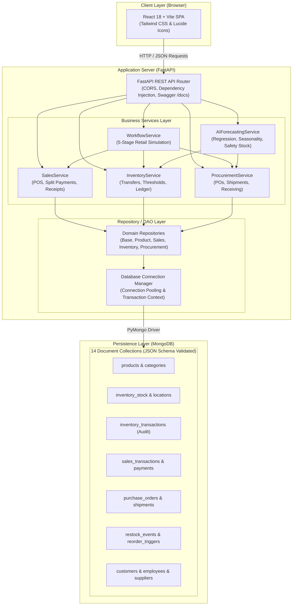

# SmartRetail — Intelligent Retail Management Platform

[](https://www.python.org/)
[](https://fastapi.tiangolo.com/)
[](https://www.mongodb.com/)
[](https://react.dev/)
[](https://vitejs.dev/)
[](https://tailwindcss.com/)
[](https://pytest.org/)
[](LICENSE)

An enterprise-grade, full-stack retail operations platform combining multi-location inventory synchronization, point-of-sale (POS) checkout, supplier procurement workflows, business intelligence analytics, and AI-driven demand forecasting.

---

## 1. Business Problem & Solution

### The Challenge
Modern retail supermarkets and grocery chains face severe operational fragmentation:
* **Inventory Desynchronization:** Stock discrepancies between bulk back-of-store warehouses and front-of-store retail display shelves lead to phantom stockouts and customer churn.
* **Reactive Replenishment:** Manual reordering relies on human intuition, causing costly over-stocking of perishables or unexpected stockouts of high-velocity goods.
* **Fragmented Procurement & POS:** Point-of-sale registers, purchase order issuance, inbound shipment receiving, and supplier records frequently operate in disconnected silos.
* **Overdraft & Race Conditions:** Concurrent point-of-sale checkout operations risk selling negative or unallocated stock.

### The SmartRetail Solution
**SmartRetail** provides an end-to-end, unified platform that synchronizes every stage of the retail lifecycle:
* **Multi-Tier Inventory Architecture:** Enforces physical separation and automated synchronization between `WAREHOUSE` (bulk storage) and `SHELF` (display/dispensing) locations.
* **Atomic Concurrency Control:** Guarantees strict non-negative inventory via conditional atomic mutations (`$inc` guarded with `$gte`) and immutable transaction ledgers.
* **Autonomous Replenishment Engine:** Automatically generates internal shelf restock transfers when displays drop below threshold, and drafts supplier purchase orders when warehouse reserves breach safety limits.
* **AI Demand Forecasting:** Employs empirical sales velocity regression, day-of-week seasonality weighting, 95% confidence intervals, and operations-research safety stock formulas to predict stockouts and recommend proactive reorder quantities.

---

## 2. Overview

SmartRetail brings together all operational workflows required to run a high-throughput retail business:

```
[ Inbound Shipments ] ──> [ Central Warehouse ] ──> [ Retail Display Shelves ] ──> [ Customer POS Checkout ]
        │                            │                            │                            │
        │                            │                            ▼                            ▼
  Reconciliation               Safety Stock               Automated Restock             Split Payments
   Against POs               Breach Triggers                Event Triggers             (Cash/Card/UPI)
        │                            │
        ▼                            ▼
[ Supplier Directory ] <── [ Auto-Drafted POs ] <────────────── [ AI Predictive Optimization Engine ]
```

Every product addition, receiving event, internal transfer, POS sale, and threshold adjustment is persisted with transactional integrity in MongoDB and reflected in real time across the executive dashboard.

---

## 3. Key Features

### Executive Management Dashboard
* Real-time operational KPIs: total active catalog SKUs, aggregate units on hand, monthly gross revenue, active low-stock alerts, and pending purchase orders.
* Interactive 7-day revenue velocity charts, category revenue share breakdowns, and immediate priority action alerts.
* Single-click trigger for end-to-end retail workflow simulations.

### Product Catalogue Management
* Centralized SKU registry tracking universal barcodes, product categorization, unit of measure (e.g., Units, Bags, Bottles), standard retail unit prices, and active operational states.
* Full-text search and category filtering with instant server-side pagination.
* Product CRUD operations with strict unique SKU/barcode validation.

### Multi-Location Shelf & Warehouse Inventory
* Hierarchical inventory mapping tracking quantities separately across `WAREHOUSE` and `SHELF` locations.
* Location-specific safety thresholds (`reorder_threshold`) and replenishment batch sizes (`reorder_quantity`).
* Direct intra-facility inventory transfers with origin stock validation.
* Immutable audit ledger (`inventory_transactions`) recording movement types: `RECEIPT`, `TRANSFER_IN`, `TRANSFER_OUT`, `SALE`, and `ADJUSTMENT`.

### Point of Sale (POS) Terminal & Split Payments
* Cashier checkout register with customer assignment (or guest checkout).
* Dynamic cart calculation with real-time stock availability verification against shelf storage.
* Multi-tender split settlement supporting Cash, Credit Card, Debit Card, UPI, Digital Wallet, and Loyalty Points.
* Instant generation of itemized, printable sales receipts with unique receipt numbers and audit attribution.

### Supplier & Vendor Management
* Master supplier directory maintaining business contact details, GST identification numbers, physical addresses, and performance ratings (1–5 scale).
* Track active supplier relationships and contracted procurement partners.

### Purchase Orders & Procurement
* Complete procurement lifecycle tracking: `PENDING`, `APPROVED`, `SHIPPED`, `PARTIALLY_RECEIVED`, `RECEIVED`, and `CANCELLED`.
* Embedded line items capturing contracted procurement unit costs, ordered quantities, and received quantities.
* Manual PO generation and automated purchase order generation triggered by low stock or AI recommendations.

### Inbound Logistics & Shipment Receiving
* Tracking numbers, logistics carriers, shipment dates, and expected delivery windows.
* Inbound receiving reconciliation: increment warehouse inventory balances, update PO line statuses, and log immutable `RECEIPT` audit ledger entries.
* Rejection protection against double-receiving previously fulfilled consignments.

### Autonomous Replenishment Engine
* **Shelf Depletion:** When a POS transaction reduces shelf stock to or below `reorder_threshold`, the system automatically logs a `RestockEvent` (`PENDING`) for internal warehouse-to-shelf replenishment.
* **Warehouse Safety Stock Breach:** When warehouse stock drops below safety limits, the system creates a `ReorderTrigger` (`OPEN`) with pre-calculated replenishment quantities for supplier reordering.

### Analytics & Reporting
* **Category Revenue Breakdown:** Aggregated revenue and sales volume distribution across product families.
* **Best-Selling Products:** Top-performing SKUs ranked by revenue and units sold.
* **Enterprise Inventory Valuation:** Monetary valuation of stock on hand calculated across warehouse and shelf locations.

### AI Demand Forecasting & Stockout Risk Analysis
* Multi-horizon forward projections (7-day and 14-day horizons) computed at the individual SKU and portfolio level.
* Day-of-week seasonality adjustments reflecting weekend retail demand spikes.
* 95% statistical confidence intervals ($Z = 1.96$) bounding future demand uncertainty.
* Dynamic stockout risk classification (`HIGH`, `MEDIUM`, `LOW`) derived from calculated inventory runout runway.
* Operations-research safety stock ($SS$) and Reorder Point ($ROP$) calibration with 1-click execution to update inventory thresholds or auto-generate supplier POs.

---

## 4. Technology Stack

| Layer | Technologies | Purpose |
|:---|:---|:---|
| **Frontend** | React 18, Vite 6, Tailwind CSS 3 | Single-page enterprise interface with responsive layouts and graphite-and-teal design system |
| **Icons & UI** | Lucide React | Consistent, scalable vector iconography |
| **Charts** | Custom SVG Chart Engine | Lightweight, responsive SVG time-series, bar, and donut charts without third-party bundle overhead |
| **Backend API** | FastAPI 0.115+, Uvicorn 0.32+ | High-performance asynchronous REST API framework with automatic OpenAPI documentation |
| **Data Validation** | Pydantic v2 | Strict schema validation, request/response models, and type safety |
| **Database** | MongoDB 7.0+ / 8.0+ | Document database utilizing native JSON Schema validation, embedded subdocuments, arrays, and compound indexes |
| **Driver** | PyMongo 4.9+ | Python MongoDB driver providing connection pooling, transaction context management, and aggregation pipelines |
| **AI / Analytics** | NumPy | Mathematical time-series trend fitting (`np.polyfit`), statistical standard deviation, and operations-research safety stock algorithms |
| **Testing** | Pytest 8.0+, pytest-asyncio | Automated regression test suite validating schemas, transactional consistency, and API resilience |

---

## 5. System Architecture



---

## 6. Project Structure

```
D:\PROJECTS\DBMS\
├── README.md                           # Main project documentation (this file)
├── .gitignore                          # Git exclusion rules (credentials, node_modules, venv)
│
├── da3_mongodb/                        # MongoDB Full-Stack Implementation Root
│   ├── requirements.txt                # Python backend dependencies
│   ├── .env.example                    # Template environment variables for backend
│   │
│   ├── scripts/                        # Database management & initialization scripts
│   │   ├── setup_database.py           # Python script to build collections, validators & indexes
│   │   ├── seed_data.py                # Python deterministic supermarket test data seeder
│   │   ├── create_validators.js        # MongoDB JSON Schema validation rules (mongosh)
│   │   ├── create_indexes.js           # Compound & unique indexes (mongosh)
│   │   └── seed_data.js                # Database seeder (mongosh)
│   │
│   ├── src/                            # Backend application source code
│   │   ├── api.py                      # FastAPI application entry point & route definitions
│   │   ├── database.py                 # PyMongo connection pooling & transaction handlers
│   │   ├── models.py                   # Pydantic domain models & request schemas
│   │   ├── main.py                     # CLI master workflow & query demonstration runner
│   │   │
│   │   ├── repositories/               # Data Access Object (DAO) layer
│   │   │   ├── base_repository.py      # Abstract generic PyMongo operations
│   │   │   ├── customer_repository.py  # Customer queries and loyalty points
│   │   │   ├── product_repository.py   # Product catalogue & category operations
│   │   │   ├── inventory_repository.py # Multi-location stock and transactions
│   │   │   ├── sales_repository.py     # Sales transactions and split payments
│   │   │   └── procurement_repository.py # POs and inbound shipments
│   │   │
│   │   └── services/                   # Business logic and domain orchestration
│   │       ├── inventory_service.py    # Stock transfers, alerts, and threshold updates
│   │       ├── sales_service.py        # POS checkout, atomic decrement, and receipting
│   │       ├── procurement_service.py  # PO generation and shipment receiving
│   │       ├── workflow_service.py     # End-to-end retail workflow orchestrator
│   │       └── ai_forecasting_service.py # Time-series regression & safety stock optimization
│   │
│   ├── queries/                        # Verified query scripts
│   │   ├── business_queries.py         # 15 canonical PyMongo business queries
│   │   ├── crud_examples.js            # MongoDB shell CRUD operations
│   │   ├── aggregation_examples.js     # Pipeline aggregations ($group, $match, $sort)
│   │   └── lookup_examples.js          # Multi-collection $lookup joins
│   │
│   ├── tests/                          # Automated Pytest suite (29 tests)
│   │   ├── conftest.py                 # Isolated test database fixtures
│   │   ├── test_validators_indexes.py  # Schema validation & unique constraint tests
│   │   ├── test_sales_and_stock.py     # Atomic stock decrement & overdraft tests
│   │   ├── test_workflow_inventory.py  # Multi-location transfers & PO generation tests
│   │   ├── test_aggregations.py        # Revenue & inventory valuation aggregations
│   │   ├── test_ai_forecasting.py      # Regression, horizon, and ROP tests
│   │   └── test_workflow_resilience.py # Multi-run workflow idempotency tests
│   │
│   └── frontend/                       # React + Vite Frontend Application
│       ├── package.json                # Frontend dependencies and scripts
│       ├── vite.config.js              # Vite server configuration
│       ├── tailwind.config.js          # Tailwind theme and custom color palette
│       ├── index.html                  # HTML5 application shell
│       ├── .env.example                # Template environment variables for frontend
│       │
│       └── src/
│           ├── main.jsx                # React application entry point
│           ├── App.jsx                 # Main navigation layout & notification state
│           ├── index.css               # Global Tailwind CSS styles
│           │
│           ├── components/             # Reusable UI components
│           │   ├── Header.jsx          # Top bar with demo runner & refresh triggers
│           │   ├── Sidebar.jsx         # Graphite navigation bar & DB status badge
│           │   ├── Modal.jsx           # Accessible dialog container
│           │   ├── Notification.jsx    # Toast alert system
│           │   └── Charts.jsx          # Responsive SVG Line, Bar, and Donut charts
│           │
│           ├── pages/                  # Page views
│           │   ├── DashboardPage.jsx   # Executive overview & KPIs
│           │   ├── ProductsPage.jsx    # Catalog management & SKU CRUD
│           │   ├── InventoryPage.jsx   # Shelf/warehouse stock & transfers
│           │   ├── SalesPage.jsx       # POS register & receipt modal
│           │   ├── SuppliersPage.jsx   # Vendor registry management
│           │   ├── PurchaseOrdersPage.jsx # PO creation & status tracking
│           │   ├── ShipmentsPage.jsx   # Freight receiving reconciliation
│           │   ├── ReorderPage.jsx     # Replenishment triggers & restock events
│           │   ├── AIForecastPage.jsx  # AI demand prediction & ROP optimization
│           │   └── ReportsPage.jsx     # BI analytics & inventory valuation
│           │
│           └── services/
│               └── api.js              # Unified REST client with error resilience
```

---

## 7. Prerequisites

Before installing, ensure the following software is installed on your workstation:

* **Python:** Version 3.10 or higher (tested on Python 3.13.0).
* **Node.js:** Version 18.0 or higher with **npm** (tested on Node.js v20+).
* **MongoDB:** MongoDB Community Server 7.0+ or 8.0+ running locally on port `27017`, or a connection string to a **MongoDB Atlas** cluster.
* **Git:** Git version control tool.

---

## 8. Local Installation and Setup

Follow these steps to set up and run the full SmartRetail stack on Windows using PowerShell.

### Step 1: Clone the Repository
Open PowerShell and clone the project:
```powershell
git clone https://github.com/SriPriyanD07/AI-POWERED-INVENTORY-AND-SALES-MANAGEMENT-.git
cd AI-POWERED-INVENTORY-AND-SALES-MANAGEMENT-
```

### Step 2: Configure Python Virtual Environment
Create and activate an isolated Python virtual environment:
```powershell
python -m venv venv
.\venv\Scripts\Activate.ps1
```

### Step 3: Install Backend Dependencies
```powershell
pip install -r da3_mongodb/requirements.txt
```

### Step 4: Configure Backend Environment Variables
Copy the template configuration file:
```powershell
Copy-Item da3_mongodb\.env.example da3_mongodb\.env
```
Ensure MongoDB is running locally on `localhost:27017` (default) or edit `da3_mongodb/.env` to provide your MongoDB Atlas URI.

### Step 5: Initialize the Database and Seed Data
Execute the setup scripts to apply JSON Schema validators, create performance indexes, and seed realistic supermarket data:
```powershell
python da3_mongodb/scripts/setup_database.py
python da3_mongodb/scripts/seed_data.py
```

### Step 6: Start the FastAPI Backend
Start the backend server in **Terminal 1**:
```powershell
# Ensure virtual environment is active
uvicorn da3_mongodb.src.api:app --reload --host 127.0.0.1 --port 8000
```
* The API will become available at `http://127.0.0.1:8000`.
* Interactive Swagger UI will be available at `http://127.0.0.1:8000/docs`.

### Step 7: Configure and Launch the Frontend
Open a **new separate terminal window (Terminal 2)** for the frontend:
```powershell
cd da3_mongodb\frontend
Copy-Item .env.example .env
npm install
npm run dev
```
* The React single-page application will launch at `http://localhost:5173`.
* Navigate to `http://localhost:5173` in any modern web browser to access the SmartRetail dashboard.

---

## 9. Environment Variables

### Backend Configuration (`da3_mongodb/.env`)

| Variable | Default Value | Description |
|:---|:---|:---|
| `MONGODB_URI` | `mongodb://localhost:27017/` | Connection URI for local MongoDB instance or MongoDB Atlas cluster |
| `DATABASE_NAME` | `smartretail_db` | Primary operational database name |
| `TEST_DATABASE_NAME` | `smartretail_test_db` | Isolated database name used for automated test executions |
| `APP_HOST` | `127.0.0.1` | Local network interface binding for FastAPI |
| `APP_PORT` | `8000` | Port on which the FastAPI application listens |
| `DEBUG` | `True` | Enables debug logging and verbose exception outputs |

### Frontend Configuration (`da3_mongodb/frontend/.env`)

| Variable | Default Value | Description |
|:---|:---|:---|
| `VITE_API_BASE` | `http://127.0.0.1:8000` | Base URL of the running FastAPI backend server |

> [!CAUTION]
> **Security Notice:** Never commit `.env` files containing production credentials or Atlas connection strings to public Git repositories. The repository `.gitignore` is configured to exclude all `.env` files.

---

## 10. API Documentation

FastAPI automatically generates interactive OpenAPI documentation based on Pydantic models and endpoint declarations:

* **Interactive Swagger UI:** [http://127.0.0.1:8000/docs](http://127.0.0.1:8000/docs)
* **ReDoc Interface:** [http://127.0.0.1:8000/redoc](http://127.0.0.1:8000/redoc)

### Key Route Groups

| Tag / Group | Method | Endpoint | Description |
|:---|:---:|:---|:---|
| **Health** | `GET` | `/` | System health check, database status, and collection listing |
| **Products** | `GET` | `/products` | Filtered product catalog search with pagination |
| | `POST` | `/products` | Create a new SKU with barcode and category validation |
| | `PUT` | `/products/{id}` | Update product pricing, active status, or attributes |
| | `DELETE` | `/products/{id}` | Soft-deactivate an obsolete product |
| **Inventory** | `GET` | `/inventory/all-stock` | Aggregated view of shelf and warehouse stock balances |
| | `GET` | `/inventory/low-stock` | Active stockout alerts below replenishment thresholds |
| | `POST` | `/inventory/transfer` | Execute stock transfer between warehouse and retail shelves |
| | `GET` | `/inventory/transactions` | Query immutable audit log with filters by type and SKU |
| **Sales** | `POST` | `/sales/checkout` | Process POS checkout with atomic stock decrement & split payments |
| | `GET` | `/sales/history` | Paginated sales transactions with customer and item details |
| **Procurement** | `GET` | `/procurement/purchase-orders` | Query purchase orders by status and supplier |
| | `POST` | `/procurement/purchase-orders` | Create a new purchase order with itemized lines |
| | `GET` | `/procurement/shipments` | List inbound freight consignments and tracking details |
| | `POST` | `/procurement/shipments/receive` | Reconcile shipment, increment warehouse stock, and log receipt |
| **Reorders** | `GET` | `/reorders/restock-events` | Internal warehouse-to-shelf restock event queue |
| | `POST` | `/reorders/restock-events/{id}/fulfill` | Complete internal shelf restock transfer |
| | `GET` | `/reorders/reorder-triggers` | Supplier reorder trigger queue for depleted warehouse stock |
| | `POST` | `/reorders/reorder-triggers/{id}/generate-po` | Convert reorder trigger into an active purchase order |
| **Analytics** | `GET` | `/analytics/summary` | Top-level KPI counts and gross revenue figures |
| | `GET` | `/reports/category-revenue` | Revenue aggregation grouped by product category |
| | `GET` | `/reports/best-sellers` | Top-performing merchandise SKUs by volume and value |
| | `GET` | `/reports/inventory-valuation` | Total financial valuation of stock on hand |
| **AI Demand** | `GET` | `/ai/forecast/overview` | Portfolio-wide demand predictions and risk rankings |
| | `GET` | `/ai/forecast/product/{id}` | Multi-horizon prediction with 95% confidence bounds |
| | `POST` | `/ai/forecast/apply-recommendation/{id}` | Update inventory reorder thresholds from AI recommendations |
| | `POST` | `/ai/forecast/generate-po/{id}` | Auto-generate purchase order based on recommended batch |
| **Workflow** | `POST` | `/workflow/demonstrate` | Execute complete 5-stage automated retail workflow |

---

## 11. AI Demand Forecasting

SmartRetail features a built-in predictive demand forecasting engine implemented in `da3_mongodb/src/services/ai_forecasting_service.py`.

```
[ Historical Sales Transactions ] ──> Aggregation Pipeline ──> Daily Demand Velocity
                                                                      │
                                                                      ▼
[ Statistical Time-Series Fitting ] <────────────────────── Linear Trend (y = α + β·t)
            │
            ▼
[ Seasonality Weighting ] ──> Weekend Peak Multiplier (1.25x vs 0.90x)
            │
            ▼
[ Multi-Horizon Projection ] ──> 95% Confidence Bounds: ± 1.96 · σ_d · √(1 + i/H)
            │
            ▼
[ Inventory Runway Analysis ] ──> Runout Days = Total Stock / Daily Velocity
            │
            ▼
[ Operations Research Calibration ] ──> Safety Stock: SS = 1.65 · σ_d · √L
                                    ──> Reorder Point: ROP = (d · L) + SS
```

### Mathematical Formulation
1. **Empirical Sales Velocity:**
   Queries historical completed POS transactions for each SKU, grouping daily sales quantities:
   $$\bar{d} = \frac{1}{N} \sum_{t=1}^{N} q_t, \quad \sigma_d = \sqrt{\frac{1}{N-1} \sum_{t=1}^{N} (q_t - \bar{d})^2}$$
2. **Linear Trend Fitting:**
   Estimates demand momentum using first-order polynomial regression ($y = \alpha + \beta t$) via `np.polyfit`.
3. **Day-of-Week Seasonality:**
   Applies retail weighting factors ($1.25\times$ for peak weekend traffic on Friday, Saturday, Sunday; $0.90\times$ for weekday baseline).
4. **Statistical Confidence Bounds (95% Interval):**
   Projects upper and lower demand uncertainty bounds expanding over the forecasting horizon $i \in [1, H]$:
   $$\text{Margin}_i = 1.96 \cdot \sigma_d \cdot \sqrt{1 + \frac{i}{H}}$$
5. **Inventory Runway & Risk Scoring:**
   $$\text{Runout Days} = \frac{\text{Total Stock on Hand}}{\max(0.1, \bar{d})}$$
   * **HIGH Risk:** Runout $\le 3.0$ days (imminent stockout).
   * **MEDIUM Risk:** Runout $\le 7.0$ days (buffer depletion imminent).
   * **LOW Risk:** Runout $> 7.0$ days (healthy inventory buffer).
6. **Operations Research Safety Stock & Reorder Point (ROP):**
   Assuming supplier replenishment lead time $L = 3$ days and a 95% service level factor ($Z = 1.65$):
   $$\text{Safety Stock } (SS) = \lceil 1.65 \cdot \sigma_d \cdot \sqrt{L} \rceil$$
   $$\text{Reorder Point } (ROP) = \lceil (\bar{d} \cdot L) + SS \rceil$$
   $$\text{Suggested Batch} = \max(\text{Active Reorder Quantity}, \lceil \bar{d} \cdot 14 \rceil)$$

### Cold-Start Handling & Data Limitations
* For new SKUs lacking sales transaction history, the system employs an empirical prior based on catalog unit price tier ($\text{Prior} = \max(1.5, 250 / \text{Price})$) and neutral trend ($\beta = 0$).
* As continuous POS transactions are recorded, the regression model progressively replaces priors with real empirical demand data.

---

## 12. Testing & Verification

SmartRetail includes a 29-test automated regression suite that runs against an isolated test database (`smartretail_test_db`).

### Running the Test Suite
```powershell
python -m pytest da3_mongodb/tests -v
```

### Verified Test Execution Results
```
============================= test session starts =============================
platform win32 -- Python 3.13.0, pytest-9.1.1, pluggy-1.6.0
rootdir: D:\PROJECTS\DBMS
plugins: anyio-4.12.0, asyncio-1.4.0
collected 29 items

da3_mongodb/tests/test_aggregations.py::test_revenue_by_category_aggregation PASSED [  3%]
da3_mongodb/tests/test_aggregations.py::test_receipt_lookup_join PASSED             [  6%]
da3_mongodb/tests/test_aggregations.py::test_enterprise_stock_valuation PASSED     [ 10%]
da3_mongodb/tests/test_ai_forecasting.py::test_ai_forecasting_overview PASSED       [ 13%]
da3_mongodb/tests/test_ai_forecasting.py::test_ai_product_forecast_detailed PASSED  [ 17%]
da3_mongodb/tests/test_ai_forecasting.py::test_ai_apply_recommendation PASSED       [ 20%]
da3_mongodb/tests/test_ai_forecasting.py::test_ai_generate_preventive_purchase_order PASSED [ 24%]
da3_mongodb/tests/test_ai_forecasting.py::test_ai_api_endpoints PASSED              [ 27%]
da3_mongodb/tests/test_sales_and_stock.py::test_inventory_decrement_after_sale PASSED [ 31%]
da3_mongodb/tests/test_sales_and_stock.py::test_rejection_of_sale_exceeding_stock PASSED [ 34%]
da3_mongodb/tests/test_sales_and_stock.py::test_payment_split_and_association PASSED [ 37%]
da3_mongodb/tests/test_sales_and_stock.py::test_duplicate_receipt_rejection PASSED [ 41%]
da3_mongodb/tests/test_sales_and_stock.py::test_referential_consistency_checks PASSED [ 44%]
da3_mongodb/tests/test_validators_indexes.py::test_successful_insertion_and_retrieval PASSED [ 48%]
da3_mongodb/tests/test_validators_indexes.py::test_product_updates PASSED           [ 51%]
da3_mongodb/tests/test_validators_indexes.py::test_unique_index_enforcement PASSED [ 55%]
da3_mongodb/tests/test_validators_indexes.py::test_schema_validation_rejection PASSED [ 58%]
da3_mongodb/tests/test_workflow_inventory.py::test_stock_transfer_between_locations PASSED [ 62%]
da3_mongodb/tests/test_workflow_inventory.py::test_transfer_rejections PASSED      [ 65%]
da3_mongodb/tests/test_workflow_inventory.py::test_shipment_receipt_and_replenishment PASSED [ 68%]
da3_mongodb/tests/test_workflow_inventory.py::test_purchase_order_creation_and_reorder_trigger PASSED [ 72%]
da3_mongodb/tests/test_workflow_inventory.py::test_end_to_end_workflow PASSED      [ 75%]
da3_mongodb/tests/test_workflow_resilience.py::test_first_execution_and_lifecycle PASSED [ 79%]
da3_mongodb/tests/test_workflow_resilience.py::test_repeated_workflow_execution_without_reset PASSED [ 82%]
da3_mongodb/tests/test_workflow_resilience.py::test_shipment_cannot_be_received_twice PASSED [ 86%]
da3_mongodb/tests/test_workflow_resilience.py::test_stock_safety_no_negative_quantities PASSED [ 89%]
da3_mongodb/tests/test_workflow_resilience.py::test_missing_prerequisites_error_reporting PASSED [ 93%]
da3_mongodb/tests/test_workflow_resilience.py::test_partial_failure_compensation PASSED [ 96%]
da3_mongodb/tests/test_workflow_resilience.py::test_workflow_api_status_codes_and_responses PASSED [100%]

============================= 29 passed in 5.92s ==============================
```

---

## 13. Proposed Deployment Plan

The architecture is designed for cloud-native deployment:

```
[ Frontend: Vercel / Netlify ] ──HTTPS──> [ Backend: Render / Google Cloud Run ] ──TLS──> [ Database: MongoDB Atlas ]
   (Vite Static SPA Bundle)                   (Containerized FastAPI Service)              (M0 / Dedicated Cluster)
```

* **Frontend (Vercel / Netlify):**
  * Build Command: `npm run build`
  * Publish Directory: `dist`
  * Environment Variable: `VITE_API_BASE=https://api.yourdomain.com`
* **Backend (Render / Railway / Google Cloud Run):**
  * Dockerfile / Native Python 3.10+ runtime.
  * Start Command: `uvicorn da3_mongodb.src.api:app --host 0.0.0.0 --port $PORT`
  * Environment Variables: `MONGODB_URI`, `DATABASE_NAME`, `DEBUG=False`.
* **Database (MongoDB Atlas):**
  * Deploy a multi-node replica set cluster (M0 free tier for staging or M10+ for production).
  * Whitelist cloud application egress IPs and configure strict database access credentials.

---

## 14. Security and Current Limitations

### Security Architecture
* **Environment Segregation:** All sensitive connection strings and runtime flags are decoupled into `.env` files.
* **Input Validation:** Strict Pydantic model validation on all incoming payload schemas prevents parameter tampering.
* **NoSQL Injection Prevention:** PyMongo parameterized query structures eliminate string concatenation vulnerabilities.
* **Atomic Concurrency Protection:** Stock decrements use conditional updates (`{"quantity_on_hand": {"$gte": qty}}`) to prevent race conditions during concurrent checkouts.

### Current Limitations
* **Single Store Deployment:** Current data model optimizes inventory for a single enterprise facility (one warehouse + front display shelves). Extending to multi-store retail chains requires adding a `store_id` partitioning dimension.
* **Multi-Document ACID Transactions:** Native multi-document transactions in MongoDB require a replica set or Atlas cluster. On standalone developer instances, atomic safety is guaranteed via conditional single-document updates and compensating reversal operations.

---

## 15. Roadmap & License

### Development Roadmap
- [ ] **Multi-Store Franchising:** Add multi-facility tenant partitioning and inter-store balance transfers.
- [ ] **Hardware Barcode Integration:** Direct WebHID / WebUSB scanner connectivity for the POS terminal.
- [ ] **Automated Supplier EDI:** Auto-dispatch purchase orders via direct supplier API or automated PDF email dispatch.
- [ ] **Machine Learning Enhancements:** Incorporate seasonal weather telemetry and external promotional calendars into the forecasting pipeline.

### License
This project is open-source software licensed under the [MIT License](LICENSE).
