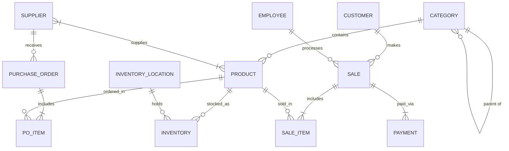
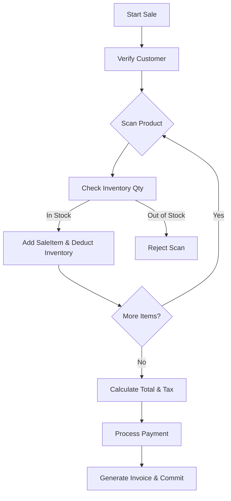

# SmartRetail: AI-Powered Inventory and Sales Management System
**University DBMS Mini-Project Presentation**

---

## Slide 1: Title Slide
- **Title:** SmartRetail: AI-Powered Inventory and Sales Management System
- **Subtitle:** Comprehensive Database Design and Implementation
- **Team:** [Your Names]
- **University:** [University Name]
- **Date:** [Date]

**Speaker Notes:**
Good morning, everyone. Welcome to our presentation on SmartRetail, an AI-powered inventory and sales management system. We developed this comprehensive database solution for our university DBMS mini-project. Today, we'll walk you through our database architecture, design choices, and how it solves modern retail challenges. Let's get started.

**Suggested Visual:**
A sleek, modern title graphic showing a high-tech retail environment or an abstract data flow connecting a storefront to a server rack.

**Time Allocation:** 1 minute

---

## Slide 2: Agenda
- Problem Statement & Existing System
- Proposed SmartRetail System
- Project Objectives & Modules
- Entity-Relationship (ER) & EER Modeling
- Relational Schema & Normalization
- Key Business Transactions
- SQL Implementation Highlights
- Design Validation & Future Scope

**Speaker Notes:**
Here is what we will cover today. We'll start by defining the problem with current retail systems and our proposed solution. Then, we will dive deep into the core of our project: the database design, including ER diagrams, EER concepts, schema, and normalization. Finally, we'll look at the key transactions, SQL features, and our plans for the future.

**Suggested Visual:**
A clean, bulleted list with subtle icons for each agenda item (e.g., a magnifying glass for problem, a database icon for schema, gears for transactions).

**Time Allocation:** 1 minute

---

## Slide 3: Problem Statement
- **Stockouts & Overstocking:** Lack of real-time inventory visibility.
- **Data Fragmentation:** Disconnected sales, inventory, and supplier records.
- **Manual Errors:** High reliance on manual data entry leads to anomalies.
- **Poor Traceability:** Difficulty tracking product origins, batches, and expirations.
- **Inefficient Restocking:** Manual reordering causes delays and lost sales.

**Speaker Notes:**
Retailers today face significant challenges in managing their inventory and sales effectively. Without real-time visibility, stores often suffer from stockouts, disappointing customers, or overstocking, which ties up capital. Furthermore, fragmented data across different systems and reliance on manual entry lead to costly errors and a lack of traceability. Our project aims to address these core issues.

**Suggested Visual:**
A split screen showing a chaotic, disorganized stockroom on one side and a frustrated cashier on the other.

**Time Allocation:** 1.5 minutes

---

## Slide 4: Existing System
- **Spreadsheet-Based Management:** Prone to data corruption and scale limits.
- **Siloed Applications:** Separate POS and inventory software that don't communicate.
- **Reactive Reordering:** Restocking only happens after shelves are empty.
- **Limited Analytics:** Inability to track customer loyalty or supplier performance.
- **Security Risks:** Lack of proper access controls and audit trails.

**Speaker Notes:**
Currently, many small to medium retailers rely on spreadsheets or outdated, siloed applications. In these existing systems, the Point of Sale doesn't talk to the inventory database in real-time. Reordering is reactive rather than proactive. Additionally, these systems lack robust analytics for customer loyalty and supplier performance, and they often have weak security and audit capabilities.

**Suggested Visual:**
An illustration of tangled wires or disjointed puzzle pieces labeled "Sales," "Inventory," and "Suppliers."

**Time Allocation:** 1.5 minutes

---

## Slide 5: Proposed System (SmartRetail)
- **Centralized Database:** Single source of truth for all retail operations.
- **Real-Time Synchronization:** Instant updates across sales, stock, and purchasing.
- **Automated Workflows:** Trigger-based restocking and inventory adjustments.
- **Comprehensive Tracking:** Full lifecycle management from supplier to customer.
- **Robust Auditing:** Complete history of data modifications.

**Speaker Notes:**
To overcome these limitations, we propose SmartRetail. SmartRetail provides a centralized, normalized database that serves as the single source of truth. The system ensures real-time synchronization between sales and inventory. It automates workflows, like triggering purchase orders when stock is low, and provides comprehensive tracking of products. Plus, every data change is logged for security and auditing.

**Suggested Visual:**
A high-level architecture diagram showing a central database communicating with POS terminals, warehouse devices, and supplier portals.

**Time Allocation:** 1.5 minutes

---

## Slide 6: Objectives
1. Design a fully normalized database (up to BCNF).
2. Eliminate data redundancy and update anomalies.
3. Model complex relationships using EER concepts.
4. Implement automated inventory thresholds and reordering.
5. Support multi-location inventory tracking (warehouses & shelves).
6. Manage comprehensive supplier and purchase order lifecycles.
7. Facilitate seamless POS transactions and split payments.
8. Enforce data integrity through constraints and triggers.
9. Track complete audit logs for all sensitive transactions.
10. Ensure high query performance for reporting.

**Speaker Notes:**
Our project had several key technical objectives. Primarily, we aimed to design a fully normalized database up to the Boyce-Codd Normal Form to eliminate redundancy. We wanted to accurately model complex real-world relationships using Extended Entity-Relationship concepts. Functionally, our objectives included automating restocking, supporting multi-location inventory, managing the full procurement lifecycle, and ensuring absolute data integrity through constraints and automated audit logs.

**Suggested Visual:**
A target or bullseye graphic surrounded by the key objectives arranged in a circle.

**Time Allocation:** 2 minutes

---

## Slide 7: System Modules
- **Inventory Management:** Products, Categories, Locations, Stock Levels, Transfers.
- **Sales & POS:** Customers, Sales, Sale Items, Payments, Returns.
- **Procurement:** Suppliers, Purchase Orders, PO Items, Shipments.
- **Administration & Security:** Employees, Roles, Audit Logs.
- **Automation:** Restock Thresholds, Inventory Adjustments.

**Speaker Notes:**
The database supports five main modules. First, Inventory Management handles products across different locations and tracks stock transfers. The Sales and POS module manages transactions, customer loyalty, and returns. The Procurement module handles everything from suppliers to receiving shipments. Administration controls employee access and audit logging. Finally, the Automation module manages thresholds and automated adjustments to keep stock levels optimal.

**Suggested Visual:**
A 5-part pie chart or interconnected nodes showing the modules.

**Time Allocation:** 1.5 minutes

---

## Slide 8: ER Diagram

**Speaker Notes:**
Here is a simplified view of our Entity-Relationship model. As you can see, we have core entities like Product, which serves as a hub connected to Categories, Suppliers, Inventory, and Sales. Notice the many-to-many relationship between Supplier and Product, which we resolve using a bridge table. Also, notice the strong relationship between Sales and Sale Items, representing a classic header-detail pattern.

**Suggested Visual:**
The Mermaid ER diagram rendered clearly, with distinct colors for the main entity groups (e.g., Sales in blue, Inventory in green).

**Time Allocation:** 2.5 minutes

---

## Slide 9: EER Concepts
- **Weak Entities:** `PurchaseOrderItem`, `SaleItem`, `ShipmentItem` (depend on their parent headers).
- **Associative Entities:** `SupplierProduct` (resolves M:N between Supplier and Product).
- **Recursive Relationships:** `Category` (self-referencing for hierarchical categories).
- **Generalization/Specialization:** `InventoryLocation` generalizes Warehouse, Shelf, Cold Storage.
- **Derived Attributes:** `total_amount` in Sale, `quantity_available` in Inventory.
- **Composite Attributes:** Name and Address fields (flattened in relational schema).

**Speaker Notes:**
To capture business complexities, we utilized Extended ER concepts. We modeled order items as Weak Entities that cannot exist without their parent orders. We used an Associative Entity to manage supplier pricing for products. Our Categories use a recursive relationship to support infinite hierarchies. We also applied generalization for Inventory Locations, and defined derived attributes like `quantity_available` which is calculated dynamically from stock on hand minus reserved stock.

**Suggested Visual:**
Small diagram snippets illustrating 2-3 specific EER concepts, like the recursive loop on Category or the weak entity double-box for SaleItem.

**Time Allocation:** 2 minutes

---

## Slide 10: Relational Schema Summary
- **20 Total Tables** ensuring complete data separation.
- **Primary Keys:** Auto-incrementing IDs for efficiency.
- **Alternate Keys (AK):** Enforced via UNIQUE constraints (e.g., SKU, Email, Invoice Number).
- **Foreign Keys:** Enforce referential integrity across all relationships.
- **Key Tables:** 
  - `Product(product_id, sku, category_id, ...)`
  - `Inventory(inventory_id, product_id, location_id, qty_on_hand, ...)`
  - `Sale(sale_id, invoice_number, customer_id, ...)`

**Speaker Notes:**
Moving to the logical design, our relational schema consists of 20 distinct tables. We used auto-incrementing surrogate Primary Keys for efficient joining, while strictly enforcing Alternate Keys—like SKU or Email—with UNIQUE constraints to prevent logical duplicates. Extensive Foreign Keys guarantee referential integrity. This slide highlights a few of the central tables that form the backbone of the application.

**Suggested Visual:**
A clean table graphic showing a few key relational schemas with PK and FK symbols clearly marked.

**Time Allocation:** 1.5 minutes

---

## Slide 11: Normalization (Up to BCNF)
- **1NF:** Eliminated multi-valued attributes (e.g., separating multiple phone numbers).
- **2NF:** Removed partial dependencies in composite key tables (e.g., `SupplierProduct`).
- **3NF:** Eliminated transitive dependencies. 
  - *Example:* Customer membership tier depends on loyalty points. Moved tier calculation to application logic or derived view to avoid storing redundant data.
- **BCNF:** Addressed anomalies where determinants were not candidate keys.

**Speaker Notes:**
Our design strictly adheres to normalization rules up to the Boyce-Codd Normal Form. We achieved 1NF by flattening composite attributes and eliminating multi-valued attributes. We met 2NF by ensuring all non-key attributes in bridge tables depend on the entire composite key. For 3NF, we aggressively removed transitive dependencies. For example, instead of storing both loyalty points and membership tier in the customer table, the tier is derived to prevent inconsistencies.

**Suggested Visual:**
A step-by-step flowchart showing a raw denormalized table breaking down into normalized tables through 1NF, 2NF, and 3NF.

**Time Allocation:** 2 minutes

---

## Slide 12: Database Schema Overview
- **Entities:** 20 Structured Tables
- **Relationships:** 37 Foreign Key Constraints
- **Data Types:** Optimized choices (`DECIMAL` for currency, `TIMESTAMP` for auditing).
- **Constraints:** 
  - `CHECK` constraints for positive values (`unit_price > 0`).
  - `DEFAULT` values for status flags and timestamps.
- **Indexes:** Strategic indexing on Foreign Keys and search fields (e.g., `sku`, `email`).

**Speaker Notes:**
Taking a holistic look at the schema, we have 20 tables connected by 37 foreign key constraints, creating a tightly woven data web. We carefully selected data types, using DECIMAL for accurate financial calculations. We heavily utilized CHECK constraints to ensure logical data entry, such as preventing negative prices or quantities. Finally, we planned strategic indexes to optimize query performance on frequently searched columns.

**Suggested Visual:**
A dashboard-style graphic displaying the statistics: "20 Tables", "37 FKs", "100% Normalized".

**Time Allocation:** 1.5 minutes

---

## Slide 13: Business Transaction: Sales Flow

**Speaker Notes:**
Let's look at a critical business transaction: the Sales Flow. When a sale starts, the system scans a product and immediately checks the real-time inventory. If stock is available, it adds the item and deducts the inventory in a single atomic transaction. Once all items are scanned, it calculates taxes, processes the payment, and commits the data. This entire workflow is wrapped in a database transaction to ensure ACID properties.

**Suggested Visual:**
The Mermaid flowchart rendered beautifully, emphasizing the atomic nature of the transaction.

**Time Allocation:** 2 minutes

---

## Slide 14: SQL Implementation Highlights
- **Complex Joins:** Generating comprehensive sales reports combining Sales, Customers, Employees, and Products.
- **Subqueries & CTEs:** Identifying top-selling products and calculating reorder necessities.
- **Window Functions:** Ranking employees by sales volume (`RANK() OVER(ORDER BY total_sales DESC)`).
- **Aggregations:** Grouping inventory by location and category to calculate total asset value.

**Speaker Notes:**
On the implementation side, we used advanced SQL features to extract meaningful insights. We utilized Common Table Expressions (CTEs) to simplify complex inventory calculations. We employed Window Functions to generate ranked reports, like identifying our top-performing employees. We also rely heavily on deep joins and aggregations to calculate total asset values across multiple warehouses in real-time.

**Suggested Visual:**
A clean, syntax-highlighted snippet of a complex SQL query (e.g., a Window Function query) next to a bar chart of the resulting data.

**Time Allocation:** 2 minutes

---

## Slide 15: Database Features (Automation)
- **Triggers:**
  - `after_sale_item_insert`: Automatically deducts `quantity_on_hand` in Inventory.
  - `before_product_update`: Logs price changes in the `AuditLog`.
- **Stored Procedures:**
  - `GeneratePurchaseOrder(product_id)`: Automates PO creation when stock drops below threshold.
- **Views:**
  - `vw_LowStockAlerts`: Consolidates data to show products needing immediate restocking.

**Speaker Notes:**
To make SmartRetail truly "smart," we pushed business logic into the database layer using advanced features. We implemented Triggers to automatically update inventory levels the moment a sale item is inserted. We created Stored Procedures that can automatically generate purchase orders when stock hits the reorder threshold. We also designed Views to provide instant, real-time dashboards for management, such as a low-stock alert feed.

**Suggested Visual:**
Icons representing gears (automation), an eye (views), and a lightning bolt (triggers) alongside brief descriptions.

**Time Allocation:** 2 minutes

---

## Slide 16: Design Validation
- **No Insertion Anomalies:** Can add a new Product without a Supplier or Sale.
- **No Deletion Anomalies:** Deleting a Category doesn't delete the Products (restricted by FK).
- **No Update Anomalies:** Updating a Supplier's address happens in one place, instantly reflecting everywhere.
- **ACID Compliance:** Transactions ensure partial sales or payments are rolled back if an error occurs.

**Speaker Notes:**
We validated our design to ensure it is robust against data anomalies. Because of our strict normalization, we can insert new products without needing an immediate supplier. Thanks to foreign key constraints, deleting a category won't accidentally orphan or delete products. Updating a supplier's address only requires changing one row. And crucially, database transactions guarantee ACID properties, meaning a system crash won't leave us with a half-recorded sale.

**Suggested Visual:**
A checklist with green checkmarks indicating "Insertion," "Deletion," "Update," and "ACID" validations passed.

**Time Allocation:** 1.5 minutes

---

## Slide 17: Future Scope
- **AI Demand Forecasting:** Integrate machine learning models to dynamically adjust `reorder_level`.
- **Data Warehousing:** Move historical data to a Snowflake/Redshift warehouse for OLAP.
- **Multi-Tenant Architecture:** Expand the schema to support franchise operations (SaaS model).
- **IoT Integration:** Connect smart shelves directly to the `InventoryAdjustment` table.

**Speaker Notes:**
While the current database is highly capable, we have clear plans for future expansion. The next step is integrating AI to analyze sales trends and dynamically adjust the reorder thresholds. As data grows, we plan to implement a Data Warehouse for heavy analytical processing. We also see potential in evolving this into a multi-tenant SaaS architecture for franchises, and integrating IoT sensors on shelves for automated inventory counting.

**Suggested Visual:**
Icons showing a robot brain (AI), a cloud server (Warehouse), and IoT sensors pointing toward the future.

**Time Allocation:** 1.5 minutes

---

## Slide 18: Conclusion & Questions
- **Summary:** SmartRetail provides a robust, normalized, and automated database foundation capable of handling modern retail complexity.
- **Impact:** Eliminates data silos, automates procurement, and ensures complete operational traceability.
- **Thank You!**

**Questions?**

**Speaker Notes:**
In conclusion, SmartRetail delivers a highly structured, normalized, and automated database solution. It eliminates traditional data silos, streamlines the procurement process, and guarantees that every item and transaction is traceable. This foundation is scalable and ready for real-world retail demands. Thank you for your time and attention. We would now be happy to answer any questions you might have about our design or implementation.

**Suggested Visual:**
A clean summary slide with "Thank You" and "Q&A" prominently displayed, with team contact info or names at the bottom.

**Time Allocation:** 1 minute
