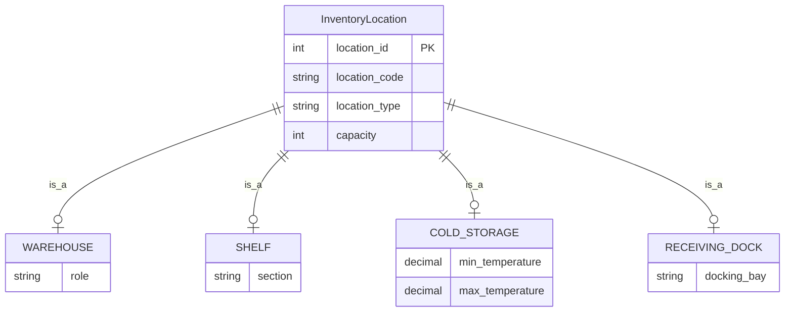
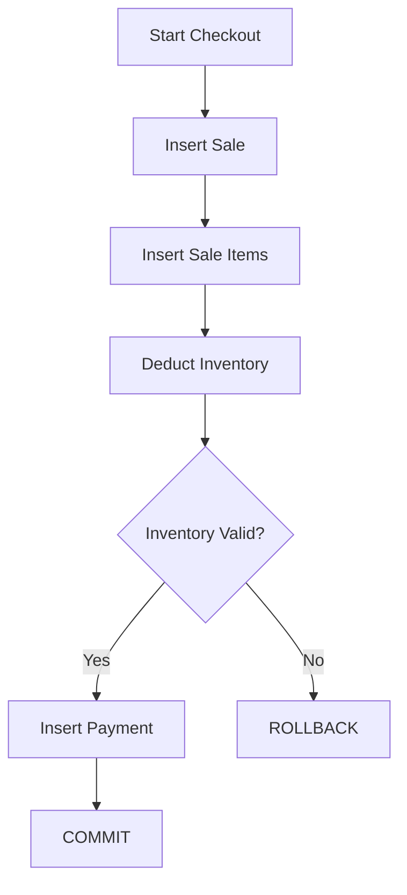
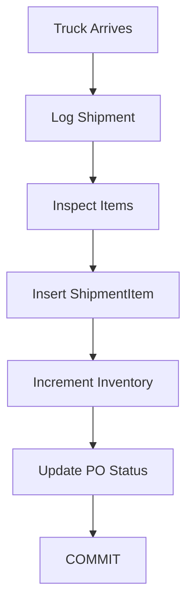
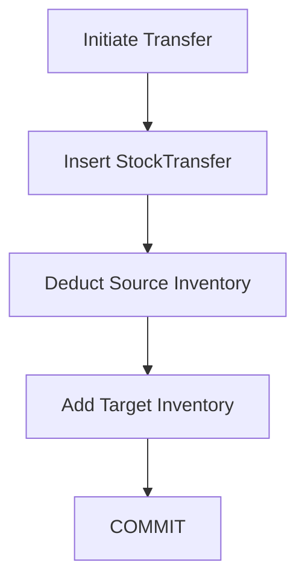
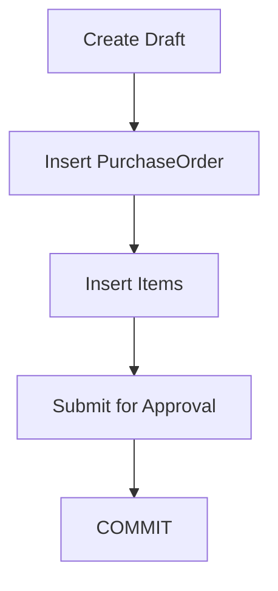
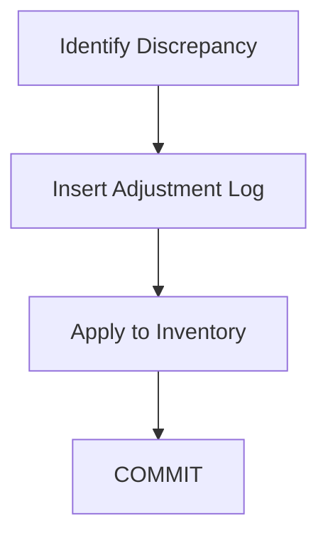
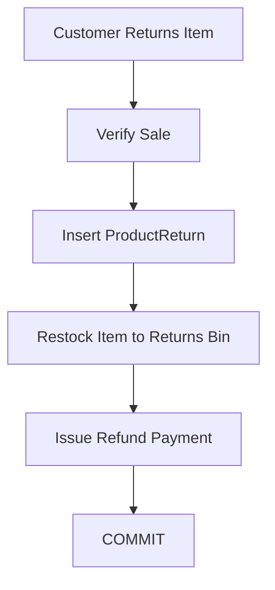

# FRONT MATTER

## Cover Page

<div align="center">
  <h3>[University Name]</h3>
  <h4>Department of Computer Science & Engineering</h4>
  <br>
  <h2>MINI-PROJECT REPORT</h2>
  <h3>SmartRetail: AI-Powered Inventory and Sales Management System</h3>
  <br>
  <p><strong>Subject:</strong> Database Management Systems (DBMS)</p>
  <br>
  <p><strong>Submitted by:</strong><br>
  [Student Name] — [USN/Roll No.]</p>
  <br>
  <p><strong>Under the Guidance of:</strong><br>
  [Faculty Name], [Designation]</p>
  <br>
  <p><strong>Academic Year:</strong> 2025–2026<br>
  <strong>Semester:</strong> [Semester]</p>
</div>

---

## Certificate

This is to certify that the mini-project entitled **"SmartRetail: AI-Powered Inventory and Sales Management System"** is a bonafide work carried out by **[Student Name]** bearing USN **[USN/Roll No.]** in partial fulfillment for the award of degree of Bachelor of Engineering in Computer Science and Engineering of [University Name] during the academic year 2025-2026. It is certified that all corrections/suggestions indicated for internal assessment have been incorporated in the report deposited in the departmental library.

The mini-project report has been approved as it satisfies the academic requirements in respect of project work prescribed for the said Degree.

<br><br>
**Signature of Guide** &nbsp;&nbsp;&nbsp;&nbsp;&nbsp;&nbsp;&nbsp;&nbsp;&nbsp;&nbsp;&nbsp;&nbsp;&nbsp;&nbsp;&nbsp;&nbsp;&nbsp;&nbsp;&nbsp;&nbsp;&nbsp;&nbsp;&nbsp;&nbsp;&nbsp;&nbsp;&nbsp;&nbsp;&nbsp;&nbsp;&nbsp;&nbsp;&nbsp;&nbsp;&nbsp;&nbsp;&nbsp;&nbsp;&nbsp;&nbsp;&nbsp;&nbsp;&nbsp;&nbsp;&nbsp;&nbsp;&nbsp;&nbsp;&nbsp;&nbsp;&nbsp;&nbsp;&nbsp;&nbsp;&nbsp;&nbsp; **Signature of HOD**

---

## Acknowledgement

We would like to express our deepest gratitude to our project guide, **[Faculty Name]**, for their continuous support, guidance, and encouragement throughout the course of this project. Their expertise and constructive feedback have been invaluable in shaping "SmartRetail."

We also extend our sincere thanks to the Head of the Department, Department of Computer Science & Engineering, and all faculty members for providing us with the necessary resources and an environment conducive to learning and innovation. Finally, we thank our peers and family for their unwavering support.

---

## Abstract

**SmartRetail** is an AI-powered Inventory and Sales Management System designed to address the operational bottlenecks faced by modern retail enterprises. Traditional retail systems often struggle with fragmented data, inefficient stock tracking, and a lack of predictive capabilities, leading to stockouts, overstocking, and suboptimal customer experiences. This project proposes a comprehensive, normalized database solution (up to Boyce-Codd Normal Form) that integrates all facets of retail management into a single, cohesive ecosystem.

The system encompasses robust modules for inventory tracking across varied storage locations (including climate-controlled environments), streamlined procurement and purchase order management, advanced sales processing with split payment support, and dynamic supplier evaluations. By leveraging relational database management principles, SmartRetail ensures data integrity, enforces strict business rules, and provides a scalable foundation for future AI integrations, such as predictive restocking and customer behavior analysis. This report details the architectural design, entity-relationship modeling, requirements analysis, and structural implementations that form the backbone of the SmartRetail database.

---

## Table of Contents

1. [CHAPTER 1: Introduction](#chapter-1-introduction)
2. [CHAPTER 2: Requirement Analysis](#chapter-2-requirement-analysis)
3. [CHAPTER 3: Entity Identification](#chapter-3-entity-identification)
4. [CHAPTER 4: Relationship Analysis](#chapter-4-relationship-analysis)
5. [CHAPTER 5: ER Model](#chapter-5-er-model)
6. [CHAPTER 6: Enhanced ER Model (EER)](#chapter-6-enhanced-er-model-eer)
7. CHAPTER 7: Relational Mapping (Coming Soon)
8. CHAPTER 8: Normalization (Coming Soon)
9. CHAPTER 9: SQL DDL Implementation (Coming Soon)
10. CHAPTER 10: SQL DML & Queries (Coming Soon)
11. CHAPTER 11: Views & Indexes (Coming Soon)
12. CHAPTER 12: Triggers & Procedures (Coming Soon)
13. CHAPTER 13: Transaction Management (Coming Soon)
14. CHAPTER 14: Security & User Roles (Coming Soon)
15. CHAPTER 15: Application Interface (Coming Soon)
16. CHAPTER 16: Testing & Validation (Coming Soon)
17. CHAPTER 17: Conclusion & Future Scope (Coming Soon)
18. CHAPTER 18: Bibliography (Coming Soon)

---

## List of Figures

- **Figure 5.1:** Complete Entity-Relationship (ER) Diagram (Mermaid)
- **Figure 6.1:** Enhanced ER (EER) Sub-diagram for Specialization

---

## List of Tables

- **Table 3.1 - 3.20:** Entity Attribute Tables
- **Table 4.1:** Relationship Analysis Summary

---

## CHAPTER 1: Introduction

### 1.1 Project Overview
SmartRetail is a centralized Database Management System (DBMS) tailored for modern retail operations. It combines procurement, inventory tracking, sales, and employee management into a unified architecture. It acts as the backbone for an AI-powered ecosystem capable of making intelligent recommendations.

### 1.2 Problem Statement
Retail stores struggle with data silos. Disconnected spreadsheets and legacy POS systems lead to data anomalies, preventing accurate stock tracking and stalling timely decision-making. There is a pressing need for a normalized, relational database approach to manage high-volume transactional data reliably.

### 1.3 Existing System
Current systems rely on fragmented databases where inventory is managed in one system and sales in another. This leads to:
- High redundancy and inconsistency.
- Poor tracking of perishable goods.
- Inability to automatically trigger purchase orders.
- Manual and error-prone audit logs.

### 1.4 Proposed System
The proposed SmartRetail system is built on a strictly normalized RDBMS (BCNF). It unifies all retail modules:
- Real-time inventory tracking across diverse locations.
- Integrated Point of Sale (POS).
- Automated supplier and procurement tracking.
- Comprehensive audit trails.

### 1.5 Objectives
- To design a database normalized to BCNF avoiding update anomalies.
- To track complex entity relationships including recursive categorizations and M:N supply chains.
- To enforce data integrity using rigorous constraints and triggers.
- To structure data for future AI consumption (e.g., predictive analytics).

### 1.6 Scope
The project scope includes the database architecture, schema design (ER and EER), SQL implementation, and transaction workflows. It covers product cataloging, supplier management, inventory movements, sales processing, and auditing. It does not cover the frontend UI implementation.

### 1.7 Advantages
- **Data Integrity:** Strict foreign key and check constraints.
- **Scalability:** Designed to handle increasing store locations and products.
- **Automation-Ready:** Structure supports automated restock triggers.
- **Comprehensive Tracking:** Every movement and adjustment is logged.

---

## CHAPTER 2: Requirement Analysis

### 2.1 Functional Requirements
1. The system must allow hierarchical product categorization.
2. The system must register and maintain product details (SKU, Barcode, Prices).
3. The system must track multiple suppliers and their products.
4. The system must manage employee records and roles.
5. The system must classify inventory locations (Warehouse, Shelf, etc.).
6. The system must track real-time inventory quantity on hand and reserved.
7. The system must allow creation and tracking of Purchase Orders (POs).
8. The system must log shipments linked to POs.
9. The system must register customer details and loyalty points.
10. The system must process sales and generate invoices.
11. The system must handle multiple payment methods per sale.
12. The system must facilitate stock transfers between locations.
13. The system must record manual inventory adjustments (damage, theft).
14. The system must manage automated restock thresholds.
15. The system must process product returns and refunds.

### 2.2 Non-functional Requirements
1. **Performance:** Database queries must execute in < 1 second.
2. **Reliability:** Data must not be lost during system crashes (ACID compliance).
3. **Security:** Only authorized roles can modify inventory.
4. **Scalability:** Must handle up to 10,000 SKUs effortlessly.
5. **Availability:** System aims for 99.9% uptime.
6. **Maintainability:** Schema must be well-documented and normalized.
7. **Usability:** Database views must simplify complex joins for reports.
8. **Integrity:** Zero orphaned records allowed.
9. **Auditability:** All critical operations must be logged.
10. **Storage:** Must efficiently handle large JSON audit payloads.

### 2.3 Assumptions
- All monetary values are in the local currency.
- A single database instance serves the retail ecosystem.
- Barcodes and SKUs are globally unique within the system.

### 2.4 Business Rules
1. Every product must belong to exactly one category.
2. A supplier can supply multiple products; a product can have multiple suppliers.
3. A purchase order must reference exactly one supplier.
4. Every PO item must belong to exactly one PO.
5. Shipments are always linked to a PO.
6. Stock transfers must have different source and destination locations.
7. Walk-in customers can make purchases without registration (customer_id NULL).
8. A sale can have multiple payments (split payment).
9. Total payments for a sale must equal the sale total_amount.
10. Inventory quantity_reserved cannot exceed quantity_on_hand.
11. When inventory at a shelf location drops below RestockThreshold.min_quantity, auto-generate a StockTransfer from warehouse.
12. When total inventory for a product drops below Product.reorder_level, auto-generate a PurchaseOrder.
13. All inventory modifications are audited in AuditLog.
14. Product returns must reference a valid sale and sale item.
15. Quantity returned cannot exceed quantity originally sold.

### 2.5 System Modules
- **Catalog Management:** Categories and Products.
- **Supplier & Procurement:** Suppliers, POs, Shipments.
- **Inventory Management:** Locations, Inventory, Transfers, Adjustments.
- **Sales & Customers:** POS integration, Loyalty, Payments.
- **Administration:** Employees and Audit Logs.

---

## CHAPTER 3: Entity Identification

Below is the detailed identification of all 20 entities in the SmartRetail schema.

**Table 3.1: Category**
| Attribute | Data Type | Key Type | Constraints | Description |
|-----------|-----------|----------|-------------|-------------|
| category_id | INT | PK | AUTO_INCREMENT | Unique ID |
| category_name | VARCHAR(100) | CK, AK | NOT NULL, UNIQUE | Category Name |
| parent_category_id | INT | FK | NULL | Recursive FK |
| description | TEXT | - | - | Description |
| is_active | BOOLEAN | - | DEFAULT TRUE | Status |

**Table 3.2: Product**
| Attribute | Data Type | Key Type | Constraints | Description |
|-----------|-----------|----------|-------------|-------------|
| product_id | INT | PK | AUTO_INCREMENT | Unique ID |
| product_name | VARCHAR(200)| - | NOT NULL | Name |
| sku | VARCHAR(50) | CK, AK | NOT NULL, UNIQUE | SKU |
| barcode | VARCHAR(50) | CK, AK | UNIQUE | Barcode |
| category_id | INT | FK | NOT NULL | FK to Category |
| unit_price | DECIMAL | - | NOT NULL, >0 | Selling price |
| cost_price | DECIMAL | - | NOT NULL, >0 | Cost |
| unit_of_measure | VARCHAR | - | DEFAULT EACH | UOM |
| reorder_level | INT | - | >=0 | Min stock alert |
| reorder_quantity| INT | - | >0 | Quantity to order|
| weight_kg | DECIMAL | - | - | Weight |
| is_perishable | BOOLEAN | - | DEFAULT FALSE | Perishable check|
| shelf_life_days | INT | - | >0 | Expiry timeframe |
| is_active | BOOLEAN | - | DEFAULT TRUE | Status |
| created_at | TIMESTAMP | - | - | Timestamp |
| updated_at | TIMESTAMP | - | - | Timestamp |

**Table 3.3: Supplier**
| Attribute | Data Type | Key Type | Constraints | Description |
|-----------|-----------|----------|-------------|-------------|
| supplier_id | INT | PK | AUTO_INCREMENT | Unique ID |
| supplier_name| VARCHAR(200)| - | NOT NULL | Name |
| contact_person| VARCHAR | - | - | Contact Name |
| email | VARCHAR(150)| CK, AK | UNIQUE | Email |
| phone | VARCHAR(20) | - | - | Phone |
| address_line1| VARCHAR(200)| - | - | Comp: Address |
| address_line2| VARCHAR(200)| - | - | Comp: Address |
| city | VARCHAR(100)| - | - | Comp: Address |
| state | VARCHAR(100)| - | - | Comp: Address |
| postal_code | VARCHAR(20) | - | - | Comp: Address |
| country | VARCHAR(100)| - | DEFAULT India | Comp: Address |
| tax_id | VARCHAR(50) | CK, AK | UNIQUE | GST/Tax ID |
| rating | DECIMAL | - | 1.0 to 5.0 | Derived |
| is_active | BOOLEAN | - | DEFAULT TRUE | Status |
| created_at | TIMESTAMP | - | - | Timestamp |

**Table 3.4: SupplierProduct**
| Attribute | Data Type | Key Type | Constraints | Description |
|-----------|-----------|----------|-------------|-------------|
| supplier_id | INT | PK, FK | - | FK to Supplier |
| product_id | INT | PK, FK | - | FK to Product |
| supply_price | DECIMAL | - | NOT NULL, >0 | Price |
| lead_time_days| INT | - | NOT NULL, >0 | Delivery time |
| minimum_order_qty| INT| - | NOT NULL, >0 | MOQ |
| is_preferred | BOOLEAN | - | DEFAULT FALSE | Priority |

**Table 3.5: Employee**
| Attribute | Data Type | Key Type | Constraints | Description |
|-----------|-----------|----------|-------------|-------------|
| employee_id | INT | PK | AUTO_INCREMENT | Unique ID |
| employee_code | VARCHAR(20) | CK, AK | NOT NULL, UNIQUE | Code |
| first_name | VARCHAR(50) | - | NOT NULL | Comp: Name |
| last_name | VARCHAR(50) | - | NOT NULL | Comp: Name |
| email | VARCHAR(150)| CK, AK | NOT NULL, UNIQUE | Email |
| phone | VARCHAR(20) | - | - | Phone |
| role | VARCHAR(30) | - | NOT NULL | Role |
| hire_date | DATE | - | NOT NULL | Date |
| is_active | BOOLEAN | - | DEFAULT TRUE | Status |
| created_at | TIMESTAMP | - | - | Timestamp |

**Table 3.6: InventoryLocation**
| Attribute | Data Type | Key Type | Constraints | Description |
|-----------|-----------|----------|-------------|-------------|
| location_id | INT | PK | AUTO_INCREMENT | Unique ID |
| location_code| VARCHAR(30) | CK, AK | NOT NULL, UNIQUE | Code |
| location_type| VARCHAR(20) | - | NOT NULL | Type |
| zone | VARCHAR(10) | - | - | Comp: Position |
| aisle | VARCHAR(10) | - | - | Comp: Position |
| rack | VARCHAR(10) | - | - | Comp: Position |
| shelf_level | VARCHAR(10) | - | - | Comp: Position |
| capacity | INT | - | NOT NULL, >0 | Capacity |
| is_temperature_controlled| BOOLEAN| - | DEFAULT FALSE | Temp controlled|
| min_temperature| DECIMAL | - | - | Min Temp |
| max_temperature| DECIMAL | - | - | Max Temp |
| is_active | BOOLEAN | - | DEFAULT TRUE | Status |

**Table 3.7: Inventory**
| Attribute | Data Type | Key Type | Constraints | Description |
|-----------|-----------|----------|-------------|-------------|
| inventory_id | INT | PK | AUTO_INCREMENT | Unique ID |
| product_id | INT | FK | NOT NULL | FK to Product |
| location_id | INT | FK | NOT NULL | FK to Location|
| quantity_on_hand| INT | - | NOT NULL, >=0 | Qty |
| quantity_reserved| INT | - | NOT NULL, >=0 | Qty |
| batch_number | VARCHAR(50) | - | - | Batch |
| expiry_date | DATE | - | - | Date |
| last_counted_at| TIMESTAMP | - | - | Timestamp |
| updated_at | TIMESTAMP | - | - | Timestamp |

*(Note: Constraint UNIQUE(product_id, location_id, batch_number))*

**Table 3.8: PurchaseOrder**
| Attribute | Data Type | Key Type | Constraints | Description |
|-----------|-----------|----------|-------------|-------------|
| po_id | INT | PK | AUTO_INCREMENT | Unique ID |
| po_number | VARCHAR(30) | CK, AK | NOT NULL, UNIQUE | PO Num |
| supplier_id | INT | FK | NOT NULL | FK to Supplier|
| order_date | DATE | - | NOT NULL | Date |
| expected_delivery_date| DATE| - | - | Date |
| status | VARCHAR(20) | - | NOT NULL | Status |
| total_amount | DECIMAL | - | - | Derived |
| created_by | INT | FK | NOT NULL | FK Employee |
| approved_by | INT | FK | NULLABLE | FK Employee |
| notes | TEXT | - | - | Notes |
| created_at | TIMESTAMP | - | - | Timestamp |
| updated_at | TIMESTAMP | - | - | Timestamp |

**Table 3.9: PurchaseOrderItem**
| Attribute | Data Type | Key Type | Constraints | Description |
|-----------|-----------|----------|-------------|-------------|
| po_item_id | INT | PK | AUTO_INCREMENT | Unique ID |
| po_id | INT | FK | NOT NULL | FK to PO |
| product_id | INT | FK | NOT NULL | FK to Product |
| quantity_ordered| INT | - | NOT NULL, >0 | Qty |
| unit_price | DECIMAL | - | NOT NULL, >0 | Price |
| quantity_received| INT | - | DEFAULT 0, >=0 | Qty |

**Table 3.10: Shipment**
| Attribute | Data Type | Key Type | Constraints | Description |
|-----------|-----------|----------|-------------|-------------|
| shipment_id | INT | PK | AUTO_INCREMENT | Unique ID |
| shipment_number| VARCHAR(30) | CK, AK | NOT NULL, UNIQUE | Ship Num |
| po_id | INT | FK | NOT NULL | FK to PO |
| supplier_id | INT | FK | NOT NULL | FK to Supplier|
| ship_date | DATE | - | - | Date |
| received_date| DATE | - | - | Date |
| status | VARCHAR(20) | - | NOT NULL | Status |
| tracking_number| VARCHAR(100)| - | - | Tracking |
| carrier | VARCHAR(100)| - | - | Carrier |
| notes | TEXT | - | - | Notes |
| created_at | TIMESTAMP | - | - | Timestamp |

**Table 3.11: ShipmentItem**
| Attribute | Data Type | Key Type | Constraints | Description |
|-----------|-----------|----------|-------------|-------------|
| shipment_item_id| INT | PK | AUTO_INCREMENT | Unique ID |
| shipment_id | INT | FK | NOT NULL | FK Shipment |
| product_id | INT | FK | NOT NULL | FK Product |
| quantity_shipped| INT | - | NOT NULL, >0 | Qty |
| quantity_accepted| INT | - | DEFAULT 0, >=0 | Qty |
| quantity_rejected| INT | - | DEFAULT 0, >=0 | Qty |
| rejection_reason| TEXT | - | - | Reason |
| destination_location_id| INT| FK | NOT NULL | FK Location |

**Table 3.12: Customer**
| Attribute | Data Type | Key Type | Constraints | Description |
|-----------|-----------|----------|-------------|-------------|
| customer_id | INT | PK | AUTO_INCREMENT | Unique ID |
| first_name | VARCHAR(50) | - | NOT NULL | Comp: Name |
| last_name | VARCHAR(50) | - | NOT NULL | Comp: Name |
| email | VARCHAR(150)| CK, AK | UNIQUE | Email |
| phone | VARCHAR(20) | CK, AK | UNIQUE | Phone |
| loyalty_points| INT | - | DEFAULT 0, >=0 | Derived |
| membership_tier| VARCHAR(20) | - | DEFAULT BRONZE | Derived |
| date_of_birth | DATE | - | - | DOB |
| registration_date| DATE | - | NOT NULL | Date |
| is_active | BOOLEAN | - | DEFAULT TRUE | Status |

**Table 3.13: Sale**
| Attribute | Data Type | Key Type | Constraints | Description |
|-----------|-----------|----------|-------------|-------------|
| sale_id | INT | PK | AUTO_INCREMENT | Unique ID |
| invoice_number| VARCHAR(30) | CK, AK | NOT NULL, UNIQUE | Inv Num |
| customer_id | INT | FK | NULLABLE | FK Customer |
| employee_id | INT | FK | NOT NULL | FK Employee |
| sale_date | TIMESTAMP | - | NOT NULL | Timestamp |
| subtotal | DECIMAL | - | NOT NULL | Derived |
| tax_rate | DECIMAL | - | NOT NULL | Tax % |
| tax_amount | DECIMAL | - | NOT NULL | Derived |
| discount_amount| DECIMAL | - | DEFAULT 0.00 | Discount |
| total_amount | DECIMAL | - | NOT NULL | Derived |
| status | VARCHAR(20) | - | DEFAULT COMPLETED| Status |

**Table 3.14: SaleItem**
| Attribute | Data Type | Key Type | Constraints | Description |
|-----------|-----------|----------|-------------|-------------|
| sale_item_id | INT | PK | AUTO_INCREMENT | Unique ID |
| sale_id | INT | FK | NOT NULL | FK Sale |
| product_id | INT | FK | NOT NULL | FK Product |
| location_id | INT | FK | NOT NULL | FK Location |
| quantity | INT | - | NOT NULL, >0 | Qty |
| unit_price | DECIMAL | - | NOT NULL, >0 | Price |
| discount_percent| DECIMAL | - | DEFAULT 0.00 | Discount % |

**Table 3.15: Payment**
| Attribute | Data Type | Key Type | Constraints | Description |
|-----------|-----------|----------|-------------|-------------|
| payment_id | INT | PK | AUTO_INCREMENT | Unique ID |
| sale_id | INT | FK | NOT NULL | FK Sale |
| payment_method| VARCHAR(20) | - | NOT NULL | Method |
| amount | DECIMAL | - | NOT NULL, >0 | Amount |
| transaction_reference| VARCHAR| CK | - | Ref |
| payment_date | TIMESTAMP | - | NOT NULL | Timestamp |
| status | VARCHAR(20) | - | NOT NULL | Status |

**Table 3.16: StockTransfer**
| Attribute | Data Type | Key Type | Constraints | Description |
|-----------|-----------|----------|-------------|-------------|
| transfer_id | INT | PK | AUTO_INCREMENT | Unique ID |
| transfer_number| VARCHAR(30) | CK, AK | NOT NULL, UNIQUE | Num |
| product_id | INT | FK | NOT NULL | FK Product |
| source_location_id| INT | FK | NOT NULL | FK Location |
| destination_location_id| INT| FK | NOT NULL | FK Location |
| quantity | INT | - | NOT NULL, >0 | Qty |
| transfer_date | TIMESTAMP | - | NOT NULL | Timestamp |
| initiated_by | INT | FK | NOT NULL | FK Employee |
| status | VARCHAR(20) | - | DEFAULT PENDING | Status |
| reason | TEXT | - | - | Reason |
| batch_number | VARCHAR(50) | - | - | Batch |

**Table 3.17: InventoryAdjustment**
| Attribute | Data Type | Key Type | Constraints | Description |
|-----------|-----------|----------|-------------|-------------|
| adjustment_id | INT | PK | AUTO_INCREMENT | Unique ID |
| product_id | INT | FK | NOT NULL | FK Product |
| location_id | INT | FK | NOT NULL | FK Location |
| adjustment_type| VARCHAR(20) | - | NOT NULL | Type |
| quantity_change| INT | - | NOT NULL | Qty |
| reason | TEXT | - | NOT NULL | Reason |
| adjusted_by | INT | FK | NOT NULL | FK Employee |
| adjustment_date| TIMESTAMP | - | NOT NULL | Timestamp |
| batch_number | VARCHAR(50) | - | - | Batch |

**Table 3.18: RestockThreshold**
| Attribute | Data Type | Key Type | Constraints | Description |
|-----------|-----------|----------|-------------|-------------|
| threshold_id | INT | PK | AUTO_INCREMENT | Unique ID |
| product_id | INT | FK | NOT NULL | FK Product |
| location_id | INT | FK | NOT NULL | FK Location |
| min_quantity | INT | - | NOT NULL, >=0 | Min Qty |
| max_quantity | INT | - | NOT NULL, >0 | Max Qty |
| restock_quantity| INT | - | NOT NULL, >0 | Restock Qty |
| auto_reorder | BOOLEAN | - | DEFAULT TRUE | Flag |

**Table 3.19: ProductReturn**
| Attribute | Data Type | Key Type | Constraints | Description |
|-----------|-----------|----------|-------------|-------------|
| return_id | INT | PK | AUTO_INCREMENT | Unique ID |
| return_number | VARCHAR(30) | CK, AK | NOT NULL, UNIQUE | Num |
| sale_id | INT | FK | NOT NULL | FK Sale |
| sale_item_id | INT | FK | NOT NULL | FK SaleItem |
| customer_id | INT | FK | NULLABLE | FK Customer |
| product_id | INT | FK | NOT NULL | FK Product |
| quantity_returned| INT | - | NOT NULL, >0 | Qty |
| reason | TEXT | - | NOT NULL | Reason |
| return_date | TIMESTAMP | - | NOT NULL | Timestamp |
| refund_amount | DECIMAL | - | NOT NULL, >=0 | Amount |
| status | VARCHAR(20) | - | DEFAULT PENDING | Status |
| processed_by | INT | FK | NULLABLE | FK Employee |
| return_to_location_id| INT | FK | NULLABLE | FK Location |

**Table 3.20: AuditLog**
| Attribute | Data Type | Key Type | Constraints | Description |
|-----------|-----------|----------|-------------|-------------|
| log_id | BIGINT | PK | AUTO_INCREMENT | Unique ID |
| table_name | VARCHAR(50) | - | NOT NULL | Table |
| record_id | INT | - | NOT NULL | ID |
| action | VARCHAR(10) | - | NOT NULL | Action |
| old_values | JSON | - | - | Previous |
| new_values | JSON | - | - | Current |
| performed_by | INT | FK | NOT NULL | FK Employee |
| performed_at | TIMESTAMP | - | NOT NULL | Timestamp |

---

## CHAPTER 4: Relationship Analysis

**Table 4.1: Relationship Analysis Summary**

| No | Entities Involved | Type | Cardinality | Participation | Description |
|----|-------------------|------|-------------|---------------|-------------|
| 1 | Category-Category | Recursive | 1:M | Optional | Sub-categories |
| 2 | Category-Product | 1:M | 1:M | Total (Product) | Classification |
| 3 | Supplier-Product | M:N | M:N | Partial | Resolved via SupplierProduct |
| 4 | Supplier-PurchaseOrder | 1:M | 1:M | Partial | Supplier orders |
| 5 | PurchaseOrder-POItem | Weak | 1:M | Total | Identifying |
| 6 | Product-POItem | 1:M | 1:M | Total (Item) | Ordered items |
| 7 | PurchaseOrder-Shipment | 1:M | 1:M | Partial | PO shipments |
| 8 | Supplier-Shipment | 1:M | 1:M | Partial | Fulfillment |
| 9 | Shipment-ShipmentItem | Weak | 1:M | Total | Identifying |
| 10 | Product-ShipmentItem | 1:M | 1:M | Total (Item) | Shipped items |
| 11 | Location-ShipmentItem | 1:M | 1:M | Total (Item) | Destination |
| 12 | Product-Inventory | 1:M | 1:M | Total (Inv) | Stored product |
| 13 | Location-Inventory | 1:M | 1:M | Total (Inv) | Storage site |
| 14 | Customer-Sale | 1:M | 1:M | Optional | Purchases |
| 15 | Employee-Sale | 1:M | 1:M | Total (Sale) | Cashier |
| 16 | Sale-SaleItem | Weak | 1:M | Total | Identifying |
| 17 | Product-SaleItem | 1:M | 1:M | Total (Item) | Sold product |
| 18 | Location-SaleItem | 1:M | 1:M | Total (Item) | Picked from |
| 19 | Sale-Payment | 1:M | 1:M | Partial | Split payments |
| 20 | Employee-PurchaseOrder | 1:M | 1:M | Total (PO) | Creator |
| 21 | Employee-PurchaseOrder | 1:M | 1:M | Optional | Approver |
| 22 | Product-StockTransfer | 1:M | 1:M | Total (Transfer) | Moving goods |
| 23 | Location-StockTransfer | 1:M | 1:M | Total (Transfer) | Source |
| 24 | Location-StockTransfer | 1:M | 1:M | Total (Transfer) | Destination |
| 25 | Employee-StockTransfer | 1:M | 1:M | Total (Transfer) | Initiator |
| 26 | Product-InventoryAdj | 1:M | 1:M | Total (Adj) | Adjusted good |
| 27 | Location-InventoryAdj | 1:M | 1:M | Total (Adj) | Adj site |
| 28 | Employee-InventoryAdj | 1:M | 1:M | Total (Adj) | Adjuster |
| 29 | Product-RestockThreshold | 1:M | 1:M | Total (Thresh) | Product limit |
| 30 | Location-RestockThreshold| 1:M | 1:M | Total (Thresh) | Site limit |
| 31 | Sale-ProductReturn | 1:M | 1:M | Total (Return) | Return ref |
| 32 | SaleItem-ProductReturn | 1:M | 1:M | Total (Return) | Item ref |
| 33 | Customer-ProductReturn | 1:M | 1:M | Optional | Returner |
| 34 | Product-ProductReturn | 1:M | 1:M | Total (Return) | Returned good |
| 35 | Employee-ProductReturn | 1:M | 1:M | Total (Return) | Processor |
| 36 | Location-ProductReturn | 1:M | 1:M | Optional | Re-stock to |
| 37 | Employee-AuditLog | 1:M | 1:M | Total (Log) | Performer |

### Detailed Relationship Explanations
Every M:N relationship (like Supplier-Product) is normalized into an Associative Entity (SupplierProduct) featuring relationship attributes (`supply_price`, `lead_time_days`). Weak entities (PurchaseOrderItem, ShipmentItem, SaleItem) cannot exist without their parent and use identifying relationships. The Category relationship is recursive, allowing infinite nesting of hierarchical taxonomies.

---

## CHAPTER 5: ER Model

### 5.1 Mermaid ER Diagram

```mermaid
erDiagram
    Category ||--o{ Category : "parent_category_id"
    Category ||--|{ Product : "contains"
    Supplier ||--o{ SupplierProduct : "supplies"
    Product ||--o{ SupplierProduct : "supplied_by"
    Supplier ||--o{ PurchaseOrder : "receives"
    PurchaseOrder ||--|{ PurchaseOrderItem : "has"
    Product ||--o{ PurchaseOrderItem : "ordered_in"
    PurchaseOrder ||--o{ Shipment : "fulfilled_by"
    Supplier ||--o{ Shipment : "sends"
    Shipment ||--|{ ShipmentItem : "contains"
    Product ||--o{ ShipmentItem : "shipped_as"
    InventoryLocation ||--o{ ShipmentItem : "destination"
    Product ||--o{ Inventory : "stored_as"
    InventoryLocation ||--o{ Inventory : "stores"
    Customer ||--o{ Sale : "makes"
    Employee ||--o{ Sale : "processes"
    Sale ||--|{ SaleItem : "has"
    Product ||--o{ SaleItem : "sold_as"
    InventoryLocation ||--o{ SaleItem : "sold_from"
    Sale ||--o{ Payment : "paid_via"
    Employee ||--o{ PurchaseOrder : "creates"
    Employee ||--o{ PurchaseOrder : "approves"
    Product ||--o{ StockTransfer : "transferred"
    InventoryLocation ||--o{ StockTransfer : "source"
    InventoryLocation ||--o{ StockTransfer : "destination"
    Employee ||--o{ StockTransfer : "initiates"
    Product ||--o{ InventoryAdjustment : "adjusted"
    InventoryLocation ||--o{ InventoryAdjustment : "adjusted_at"
    Employee ||--o{ InventoryAdjustment : "adjusted_by"
    Product ||--o{ RestockThreshold : "monitored"
    InventoryLocation ||--o{ RestockThreshold : "monitored_at"
    Sale ||--o{ ProductReturn : "returned_from"
    SaleItem ||--o{ ProductReturn : "returned_item"
    Customer ||--o{ ProductReturn : "returns"
    Product ||--o{ ProductReturn : "returned_product"
    Employee ||--o{ ProductReturn : "processed_by"
    InventoryLocation ||--o{ ProductReturn : "returned_to"
    Employee ||--o{ AuditLog : "performs"
```



### 5.2 Crow's Foot Notation Explanation
- **`||--o{` (1 to 0..M):** One entity can be associated with zero or many of another. E.g., a Supplier might not have active shipments, but can have many.
- **`||--|{` (1 to 1..M):** One entity must be associated with at least one of another. E.g., a Sale MUST have at least one SaleItem.
- **Total vs Partial Participation:** Represented implicitly. Identifying relationships (Weak Entities) enforce total participation of the child to the parent.

### 5.3 DBML Implementation Code

```dbml
Table Category {
  category_id INT [pk, increment]
  category_name VARCHAR(100) [not null, unique]
  parent_category_id INT
  description TEXT
  is_active BOOLEAN [default: true]
}

Table Product {
  product_id INT [pk, increment]
  product_name VARCHAR(200) [not null]
  sku VARCHAR(50) [not null, unique]
  barcode VARCHAR(50) [unique]
  category_id INT [not null]
  unit_price DECIMAL(10,2) [not null]
  cost_price DECIMAL(10,2) [not null]
  unit_of_measure VARCHAR(20) [not null, default: 'EACH']
  reorder_level INT [not null, default: 10]
  reorder_quantity INT [not null, default: 50]
  weight_kg DECIMAL(8,3)
  is_perishable BOOLEAN [default: false]
  shelf_life_days INT
  is_active BOOLEAN [default: true]
  created_at TIMESTAMP [default: `CURRENT_TIMESTAMP`]
  updated_at TIMESTAMP
}

Table Supplier {
  supplier_id INT [pk, increment]
  supplier_name VARCHAR(200) [not null]
  contact_person VARCHAR(100)
  email VARCHAR(150) [unique]
  phone VARCHAR(20)
  address_line1 VARCHAR(200)
  address_line2 VARCHAR(200)
  city VARCHAR(100)
  state VARCHAR(100)
  postal_code VARCHAR(20)
  country VARCHAR(100) [default: 'India']
  tax_id VARCHAR(50) [unique]
  rating DECIMAL(2,1)
  is_active BOOLEAN [default: true]
  created_at TIMESTAMP [default: `CURRENT_TIMESTAMP`]
}

Table SupplierProduct {
  supplier_id INT [pk]
  product_id INT [pk]
  supply_price DECIMAL(10,2) [not null]
  lead_time_days INT [not null, default: 7]
  minimum_order_qty INT [not null, default: 1]
  is_preferred BOOLEAN [default: false]
}

Table Employee {
  employee_id INT [pk, increment]
  employee_code VARCHAR(20) [not null, unique]
  first_name VARCHAR(50) [not null]
  last_name VARCHAR(50) [not null]
  email VARCHAR(150) [not null, unique]
  phone VARCHAR(20)
  role VARCHAR(30) [not null]
  hire_date DATE [not null]
  is_active BOOLEAN [default: true]
  created_at TIMESTAMP [default: `CURRENT_TIMESTAMP`]
}

Table InventoryLocation {
  location_id INT [pk, increment]
  location_code VARCHAR(30) [not null, unique]
  location_type VARCHAR(20) [not null]
  zone VARCHAR(10)
  aisle VARCHAR(10)
  rack VARCHAR(10)
  shelf_level VARCHAR(10)
  capacity INT [not null]
  is_temperature_controlled BOOLEAN [default: false]
  min_temperature DECIMAL(5,2)
  max_temperature DECIMAL(5,2)
  is_active BOOLEAN [default: true]
}

Table Inventory {
  inventory_id INT [pk, increment]
  product_id INT [not null]
  location_id INT [not null]
  quantity_on_hand INT [not null, default: 0]
  quantity_reserved INT [not null, default: 0]
  batch_number VARCHAR(50)
  expiry_date DATE
  last_counted_at TIMESTAMP
  updated_at TIMESTAMP
}

Table PurchaseOrder {
  po_id INT [pk, increment]
  po_number VARCHAR(30) [not null, unique]
  supplier_id INT [not null]
  order_date DATE [not null, default: `CURRENT_DATE`]
  expected_delivery_date DATE
  status VARCHAR(20) [not null, default: 'DRAFT']
  total_amount DECIMAL(12,2)
  created_by INT [not null]
  approved_by INT
  notes TEXT
  created_at TIMESTAMP [default: `CURRENT_TIMESTAMP`]
  updated_at TIMESTAMP
}

Table PurchaseOrderItem {
  po_item_id INT [pk, increment]
  po_id INT [not null]
  product_id INT [not null]
  quantity_ordered INT [not null]
  unit_price DECIMAL(10,2) [not null]
  quantity_received INT [default: 0]
}

Table Shipment {
  shipment_id INT [pk, increment]
  shipment_number VARCHAR(30) [not null, unique]
  po_id INT [not null]
  supplier_id INT [not null]
  ship_date DATE
  received_date DATE
  status VARCHAR(20) [not null, default: 'IN_TRANSIT']
  tracking_number VARCHAR(100)
  carrier VARCHAR(100)
  notes TEXT
  created_at TIMESTAMP [default: `CURRENT_TIMESTAMP`]
}

Table ShipmentItem {
  shipment_item_id INT [pk, increment]
  shipment_id INT [not null]
  product_id INT [not null]
  quantity_shipped INT [not null]
  quantity_accepted INT [default: 0]
  quantity_rejected INT [default: 0]
  rejection_reason TEXT
  destination_location_id INT [not null]
}

Table Customer {
  customer_id INT [pk, increment]
  first_name VARCHAR(50) [not null]
  last_name VARCHAR(50) [not null]
  email VARCHAR(150) [unique]
  phone VARCHAR(20) [unique]
  loyalty_points INT [default: 0]
  membership_tier VARCHAR(20) [default: 'BRONZE']
  date_of_birth DATE
  registration_date DATE [not null, default: `CURRENT_DATE`]
  is_active BOOLEAN [default: true]
}

Table Sale {
  sale_id INT [pk, increment]
  invoice_number VARCHAR(30) [not null, unique]
  customer_id INT
  employee_id INT [not null]
  sale_date TIMESTAMP [not null, default: `CURRENT_TIMESTAMP`]
  subtotal DECIMAL(12,2) [not null]
  tax_rate DECIMAL(4,2) [not null, default: 18.00]
  tax_amount DECIMAL(12,2) [not null]
  discount_amount DECIMAL(12,2) [default: 0.00]
  total_amount DECIMAL(12,2) [not null]
  status VARCHAR(20) [default: 'COMPLETED']
}

Table SaleItem {
  sale_item_id INT [pk, increment]
  sale_id INT [not null]
  product_id INT [not null]
  location_id INT [not null]
  quantity INT [not null]
  unit_price DECIMAL(10,2) [not null]
  discount_percent DECIMAL(5,2) [default: 0.00]
}

Table Payment {
  payment_id INT [pk, increment]
  sale_id INT [not null]
  payment_method VARCHAR(20) [not null]
  amount DECIMAL(12,2) [not null]
  transaction_reference VARCHAR(100)
  payment_date TIMESTAMP [not null, default: `CURRENT_TIMESTAMP`]
  status VARCHAR(20) [not null, default: 'SUCCESS']
}

Table StockTransfer {
  transfer_id INT [pk, increment]
  transfer_number VARCHAR(30) [not null, unique]
  product_id INT [not null]
  source_location_id INT [not null]
  destination_location_id INT [not null]
  quantity INT [not null]
  transfer_date TIMESTAMP [not null, default: `CURRENT_TIMESTAMP`]
  initiated_by INT [not null]
  status VARCHAR(20) [default: 'PENDING']
  reason TEXT
  batch_number VARCHAR(50)
}

Table InventoryAdjustment {
  adjustment_id INT [pk, increment]
  product_id INT [not null]
  location_id INT [not null]
  adjustment_type VARCHAR(20) [not null]
  quantity_change INT [not null]
  reason TEXT [not null]
  adjusted_by INT [not null]
  adjustment_date TIMESTAMP [not null, default: `CURRENT_TIMESTAMP`]
  batch_number VARCHAR(50)
}

Table RestockThreshold {
  threshold_id INT [pk, increment]
  product_id INT [not null]
  location_id INT [not null]
  min_quantity INT [not null]
  max_quantity INT [not null]
  restock_quantity INT [not null]
  auto_reorder BOOLEAN [default: true]
}

Table ProductReturn {
  return_id INT [pk, increment]
  return_number VARCHAR(30) [not null, unique]
  sale_id INT [not null]
  sale_item_id INT [not null]
  customer_id INT
  product_id INT [not null]
  quantity_returned INT [not null]
  reason TEXT [not null]
  return_date TIMESTAMP [not null, default: `CURRENT_TIMESTAMP`]
  refund_amount DECIMAL(12,2) [not null]
  status VARCHAR(20) [default: 'PENDING']
  processed_by INT
  return_to_location_id INT
}

Table AuditLog {
  log_id BIGINT [pk, increment]
  table_name VARCHAR(50) [not null]
  record_id INT [not null]
  action VARCHAR(10) [not null]
  old_values JSON
  new_values JSON
  performed_by INT [not null]
  performed_at TIMESTAMP [not null, default: `CURRENT_TIMESTAMP`]
}

Ref: Category.parent_category_id > Category.category_id
Ref: Product.category_id > Category.category_id
Ref: SupplierProduct.supplier_id > Supplier.supplier_id
Ref: SupplierProduct.product_id > Product.product_id
Ref: PurchaseOrder.supplier_id > Supplier.supplier_id
Ref: PurchaseOrder.created_by > Employee.employee_id
Ref: PurchaseOrder.approved_by > Employee.employee_id
Ref: PurchaseOrderItem.po_id > PurchaseOrder.po_id
Ref: PurchaseOrderItem.product_id > Product.product_id
Ref: Shipment.po_id > PurchaseOrder.po_id
Ref: Shipment.supplier_id > Supplier.supplier_id
Ref: ShipmentItem.shipment_id > Shipment.shipment_id
Ref: ShipmentItem.product_id > Product.product_id
Ref: ShipmentItem.destination_location_id > InventoryLocation.location_id
Ref: Inventory.product_id > Product.product_id
Ref: Inventory.location_id > InventoryLocation.location_id
Ref: Sale.customer_id > Customer.customer_id
Ref: Sale.employee_id > Employee.employee_id
Ref: SaleItem.sale_id > Sale.sale_id
Ref: SaleItem.product_id > Product.product_id
Ref: SaleItem.location_id > InventoryLocation.location_id
Ref: Payment.sale_id > Sale.sale_id
Ref: StockTransfer.product_id > Product.product_id
Ref: StockTransfer.source_location_id > InventoryLocation.location_id
Ref: StockTransfer.destination_location_id > InventoryLocation.location_id
Ref: StockTransfer.initiated_by > Employee.employee_id
Ref: InventoryAdjustment.product_id > Product.product_id
Ref: InventoryAdjustment.location_id > InventoryLocation.location_id
Ref: InventoryAdjustment.adjusted_by > Employee.employee_id
Ref: RestockThreshold.product_id > Product.product_id
Ref: RestockThreshold.location_id > InventoryLocation.location_id
Ref: ProductReturn.sale_id > Sale.sale_id
Ref: ProductReturn.sale_item_id > SaleItem.sale_item_id
Ref: ProductReturn.customer_id > Customer.customer_id
Ref: ProductReturn.product_id > Product.product_id
Ref: ProductReturn.processed_by > Employee.employee_id
Ref: ProductReturn.return_to_location_id > InventoryLocation.location_id
Ref: AuditLog.performed_by > Employee.employee_id
```

---

## CHAPTER 6: Enhanced ER Model (EER)

The EER (Enhanced Entity-Relationship) model extends standard ER diagrams with advanced semantic modeling concepts. SmartRetail leverages several of these to maintain data integrity.

### 6.1 Weak Entities
Weak entities cannot be uniquely identified by their attributes alone; they depend on a strong entity (owner).
- **PurchaseOrderItem:** Depends on `PurchaseOrder`. A line item has no meaning if the PO is deleted.
- **SaleItem:** Depends on `Sale`.
- **ShipmentItem:** Depends on `Shipment`.

### 6.2 Strong Entities
Entities that possess a Primary Key and exist independently.
- Examples include `Product`, `Supplier`, `Employee`, `Customer`, `Category`, `InventoryLocation`.

### 6.3 Associative Entities
An entity used to resolve a Many-to-Many (M:N) relationship, often adding relationship-specific attributes.
- **SupplierProduct:** Resolves the M:N between `Supplier` and `Product`. It tracks `supply_price`, `lead_time_days`, and `minimum_order_qty` specific to that supplier-product pair.

### 6.4 Recursive Relationships
A relationship where an entity relates to itself.
- **Category:** A category can have a `parent_category_id` referencing another Category. This allows for N-level deep hierarchies (e.g., Electronics > Mobile Phones > Smartphones).

### 6.5 Composite Attributes
Attributes composed of multiple distinct parts. In logical modeling, these are broken down into simpler attributes to achieve First Normal Form (1NF).
- **Address (Supplier):** Broken into `address_line1`, `address_line2`, `city`, `state`, `postal_code`, `country`.
- **Name (Employee/Customer):** Broken into `first_name` and `last_name`.
- **Position (InventoryLocation):** Broken into `zone`, `aisle`, `rack`, `shelf_level`.

### 6.6 Derived Attributes
Attributes whose values are calculated from other attributes and generally do not need physical storage, or are stored via triggers for performance.
- `quantity_available` = `quantity_on_hand` - `quantity_reserved` (Inventory).
- `line_total` = `quantity_ordered` * `unit_price` (PurchaseOrderItem).
- `membership_tier` = Calculated based on `loyalty_points` (Customer).
- `rating` = Derived from supplier delivery performance.

### 6.7 Multi-valued Attributes
Attributes that can hold multiple values. In SmartRetail, these are strictly normalized:
- **Phone Numbers:** A supplier might have multiple phones. In the schema, to meet BCNF, it is reduced to a single primary phone, or would require a separate `SupplierPhone` table if multiple were strictly needed.
- **Categories:** Products map to exactly one category ID to avoid an M:N multi-valued mess, strictly enforcing normalization.

### 6.8 Generalization and Specialization
The process of defining generalized superclasses and specialized subclasses.
- **InventoryLocation (Superclass):** Generalizes shared attributes (`location_code`, `capacity`).
- **Subclasses:** `WAREHOUSE`, `SHELF`, `COLD_STORAGE`, `RECEIVING_DOCK`.
- **Attribute-Defined:** The `location_type` attribute defines the subclass.
- **Disjoint & Total:** An inventory location can only be ONE type (Disjoint) and must be at least one type (Total).
- **Specialization Attributes:** `COLD_STORAGE` uses `min_temperature` and `max_temperature`.

### 6.9 Aggregation
Aggregation models a "has-a" relationship where a relationship itself is treated as a higher-level entity.
- **Shipment Aggregating PurchaseOrder:** A `Shipment` doesn't just link to a supplier, it fulfills a `PurchaseOrder` as a whole conceptual unit, effectively aggregating the PO and its items into a transitable object.

### 6.10 EER Specialization Diagram




---

# CHAPTER 7: Relational Schema

This chapter presents the formal relational schema for the SmartRetail database, including 20 relations.

**Notation:** Primary keys are denoted by <u>underline</u>, and foreign keys are denoted by *italics*.

### 1. Category
**Schema Notation:** Category(<u>category_id</u>, category_name, *parent_category_id*, description, is_active)

| Attribute Name | Data Type | PK/FK | Candidate Keys | Constraints |
|---|---|---|---|---|
| category_id | INT | PK | {category_id}, {category_name} | AUTO_INCREMENT, NOT NULL |
| category_name | VARCHAR(100) | - | | NOT NULL, UNIQUE |
| parent_category_id | INT | FK | | REFERENCES Category(category_id) |
| description | TEXT | - | | |
| is_active | BOOLEAN | - | | DEFAULT TRUE |

### 2. Product
**Schema Notation:** Product(<u>product_id</u>, product_name, sku, barcode, *category_id*, unit_price, cost_price, unit_of_measure, reorder_level, reorder_quantity, weight_kg, is_perishable, shelf_life_days, is_active, created_at, updated_at)

| Attribute Name | Data Type | PK/FK | Candidate Keys | Constraints |
|---|---|---|---|---|
| product_id | INT | PK | {product_id}, {sku}, {barcode} | AUTO_INCREMENT, NOT NULL |
| product_name | VARCHAR(200) | - | | NOT NULL |
| sku | VARCHAR(50) | - | | NOT NULL, UNIQUE |
| barcode | VARCHAR(50) | - | | UNIQUE |
| category_id | INT | FK | | NOT NULL, REFERENCES Category(category_id) |
| unit_price | DECIMAL(10,2)| - | | NOT NULL, CHECK(unit_price > 0) |
| cost_price | DECIMAL(10,2)| - | | NOT NULL, CHECK(cost_price > 0) |
| unit_of_measure | VARCHAR(20) | - | | NOT NULL, DEFAULT 'EACH', CHECK IN (...) |
| reorder_level | INT | - | | NOT NULL, DEFAULT 10, CHECK(reorder_level >= 0) |
| reorder_quantity | INT | - | | NOT NULL, DEFAULT 50, CHECK(reorder_quantity > 0) |
| weight_kg | DECIMAL(8,3) | - | | |
| is_perishable | BOOLEAN | - | | DEFAULT FALSE |
| shelf_life_days | INT | - | | CHECK(shelf_life_days > 0) |
| is_active | BOOLEAN | - | | DEFAULT TRUE |
| created_at | TIMESTAMP | - | | DEFAULT CURRENT_TIMESTAMP |
| updated_at | TIMESTAMP | - | | DEFAULT CURRENT_TIMESTAMP ON UPDATE |

### 3. Supplier
**Schema Notation:** Supplier(<u>supplier_id</u>, supplier_name, contact_person, email, phone, address_line1, address_line2, city, state, postal_code, country, tax_id, rating, is_active, created_at)

| Attribute Name | Data Type | PK/FK | Candidate Keys | Constraints |
|---|---|---|---|---|
| supplier_id | INT | PK | {supplier_id}, {email}, {tax_id} | AUTO_INCREMENT, NOT NULL |
| supplier_name | VARCHAR(200) | - | | NOT NULL |
| contact_person | VARCHAR(100) | - | | |
| email | VARCHAR(150) | - | | UNIQUE |
| phone | VARCHAR(20) | - | | |
| address_line1 | VARCHAR(200) | - | | |
| address_line2 | VARCHAR(200) | - | | |
| city | VARCHAR(100) | - | | |
| state | VARCHAR(100) | - | | |
| postal_code | VARCHAR(20) | - | | |
| country | VARCHAR(100) | - | | DEFAULT 'India' |
| tax_id | VARCHAR(50) | - | | UNIQUE |
| rating | DECIMAL(2,1) | - | | CHECK(rating BETWEEN 1.0 AND 5.0) |
| is_active | BOOLEAN | - | | DEFAULT TRUE |
| created_at | TIMESTAMP | - | | DEFAULT CURRENT_TIMESTAMP |

### 4. SupplierProduct
**Schema Notation:** SupplierProduct(<u>*supplier_id*</u>, <u>*product_id*</u>, supply_price, lead_time_days, minimum_order_qty, is_preferred)

| Attribute Name | Data Type | PK/FK | Candidate Keys | Constraints |
|---|---|---|---|---|
| supplier_id | INT | PK, FK | {supplier_id, product_id} | REFERENCES Supplier(supplier_id) |
| product_id | INT | PK, FK | | REFERENCES Product(product_id) |
| supply_price | DECIMAL(10,2)| - | | NOT NULL, CHECK(supply_price > 0) |
| lead_time_days| INT | - | | NOT NULL, DEFAULT 7, CHECK(lead_time_days > 0) |
| minimum_order_qty| INT | - | | NOT NULL, DEFAULT 1, CHECK(minimum_order_qty > 0)|
| is_preferred | BOOLEAN | - | | DEFAULT FALSE |

### 5. Employee
**Schema Notation:** Employee(<u>employee_id</u>, employee_code, first_name, last_name, email, phone, role, hire_date, is_active, created_at)

| Attribute Name | Data Type | PK/FK | Candidate Keys | Constraints |
|---|---|---|---|---|
| employee_id | INT | PK | {employee_id}, {employee_code}, {email} | AUTO_INCREMENT, NOT NULL |
| employee_code | VARCHAR(20) | - | | NOT NULL, UNIQUE |
| first_name | VARCHAR(50) | - | | NOT NULL |
| last_name | VARCHAR(50) | - | | NOT NULL |
| email | VARCHAR(150) | - | | NOT NULL, UNIQUE |
| phone | VARCHAR(20) | - | | |
| role | VARCHAR(30) | - | | NOT NULL, CHECK IN (...) |
| hire_date | DATE | - | | NOT NULL |
| is_active | BOOLEAN | - | | DEFAULT TRUE |
| created_at | TIMESTAMP | - | | DEFAULT CURRENT_TIMESTAMP |

### 6. InventoryLocation
**Schema Notation:** InventoryLocation(<u>location_id</u>, location_code, location_type, zone, aisle, rack, shelf_level, capacity, is_temperature_controlled, min_temperature, max_temperature, is_active)

| Attribute Name | Data Type | PK/FK | Candidate Keys | Constraints |
|---|---|---|---|---|
| location_id | INT | PK | {location_id}, {location_code} | AUTO_INCREMENT, NOT NULL |
| location_code | VARCHAR(30) | - | | NOT NULL, UNIQUE |
| location_type | VARCHAR(20) | - | | NOT NULL, CHECK IN (...) |
| zone | VARCHAR(10) | - | | |
| aisle | VARCHAR(10) | - | | |
| rack | VARCHAR(10) | - | | |
| shelf_level | VARCHAR(10) | - | | |
| capacity | INT | - | | NOT NULL, CHECK(capacity > 0) |
| is_temperature_controlled | BOOLEAN| - | | DEFAULT FALSE |
| min_temperature| DECIMAL(5,2) | - | | |
| max_temperature| DECIMAL(5,2) | - | | |
| is_active | BOOLEAN | - | | DEFAULT TRUE |

### 7. Inventory
**Schema Notation:** Inventory(<u>inventory_id</u>, *product_id*, *location_id*, quantity_on_hand, quantity_reserved, batch_number, expiry_date, last_counted_at, updated_at)

| Attribute Name | Data Type | PK/FK | Candidate Keys | Constraints |
|---|---|---|---|---|
| inventory_id | INT | PK | {inventory_id}, {product_id, location_id, batch_number} | AUTO_INCREMENT, NOT NULL |
| product_id | INT | FK | | NOT NULL, REFERENCES Product |
| location_id | INT | FK | | NOT NULL, REFERENCES InventoryLocation |
| quantity_on_hand| INT | - | | NOT NULL, DEFAULT 0, CHECK(>=0) |
| quantity_reserved| INT | - | | NOT NULL, DEFAULT 0, CHECK(>=0, <= quantity_on_hand) |
| batch_number | VARCHAR(50) | - | | |
| expiry_date | DATE | - | | |
| last_counted_at| TIMESTAMP | - | | |
| updated_at | TIMESTAMP | - | | DEFAULT CURRENT_TIMESTAMP ON UPDATE |

### 8. PurchaseOrder
**Schema Notation:** PurchaseOrder(<u>po_id</u>, po_number, *supplier_id*, order_date, expected_delivery_date, status, total_amount, *created_by*, *approved_by*, notes, created_at, updated_at)

| Attribute Name | Data Type | PK/FK | Candidate Keys | Constraints |
|---|---|---|---|---|
| po_id | INT | PK | {po_id}, {po_number} | AUTO_INCREMENT, NOT NULL |
| po_number | VARCHAR(30) | - | | NOT NULL, UNIQUE |
| supplier_id | INT | FK | | NOT NULL, REFERENCES Supplier |
| order_date | DATE | - | | NOT NULL, DEFAULT CURRENT_DATE |
| expected_delivery_date | DATE | - | | CHECK(expected_delivery_date >= order_date) |
| status | VARCHAR(20) | - | | NOT NULL, DEFAULT 'DRAFT', CHECK IN (...) |
| total_amount | DECIMAL(12,2)| - | | |
| created_by | INT | FK | | NOT NULL, REFERENCES Employee |
| approved_by | INT | FK | | REFERENCES Employee |
| notes | TEXT | - | | |
| created_at | TIMESTAMP | - | | DEFAULT CURRENT_TIMESTAMP |
| updated_at | TIMESTAMP | - | | DEFAULT CURRENT_TIMESTAMP ON UPDATE |

### 9. PurchaseOrderItem
**Schema Notation:** PurchaseOrderItem(<u>po_item_id</u>, *po_id*, *product_id*, quantity_ordered, unit_price, quantity_received)

| Attribute Name | Data Type | PK/FK | Candidate Keys | Constraints |
|---|---|---|---|---|
| po_item_id | INT | PK | {po_item_id}, {po_id, product_id} | AUTO_INCREMENT, NOT NULL |
| po_id | INT | FK | | NOT NULL, REFERENCES PurchaseOrder |
| product_id | INT | FK | | NOT NULL, REFERENCES Product |
| quantity_ordered| INT | - | | NOT NULL, CHECK(quantity_ordered > 0) |
| unit_price | DECIMAL(10,2)| - | | NOT NULL, CHECK(unit_price > 0) |
| quantity_received| INT | - | | DEFAULT 0, CHECK(quantity_received >= 0 AND <= quantity_ordered) |

### 10. Shipment
**Schema Notation:** Shipment(<u>shipment_id</u>, shipment_number, *po_id*, *supplier_id*, ship_date, received_date, status, tracking_number, carrier, notes, created_at)

| Attribute Name | Data Type | PK/FK | Candidate Keys | Constraints |
|---|---|---|---|---|
| shipment_id | INT | PK | {shipment_id}, {shipment_number} | AUTO_INCREMENT, NOT NULL |
| shipment_number | VARCHAR(30) | - | | NOT NULL, UNIQUE |
| po_id | INT | FK | | NOT NULL, REFERENCES PurchaseOrder |
| supplier_id | INT | FK | | NOT NULL, REFERENCES Supplier |
| ship_date | DATE | - | | |
| received_date | DATE | - | | CHECK(received_date >= ship_date) |
| status | VARCHAR(20) | - | | NOT NULL, DEFAULT 'IN_TRANSIT', CHECK IN (...) |
| tracking_number | VARCHAR(100) | - | | |
| carrier | VARCHAR(100) | - | | |
| notes | TEXT | - | | |
| created_at | TIMESTAMP | - | | DEFAULT CURRENT_TIMESTAMP |

### 11. ShipmentItem
**Schema Notation:** ShipmentItem(<u>shipment_item_id</u>, *shipment_id*, *product_id*, quantity_shipped, quantity_accepted, quantity_rejected, rejection_reason, *destination_location_id*)

| Attribute Name | Data Type | PK/FK | Candidate Keys | Constraints |
|---|---|---|---|---|
| shipment_item_id| INT | PK | {shipment_item_id}, {shipment_id, product_id} | AUTO_INCREMENT, NOT NULL |
| shipment_id | INT | FK | | NOT NULL, REFERENCES Shipment |
| product_id | INT | FK | | NOT NULL, REFERENCES Product |
| quantity_shipped| INT | - | | NOT NULL, CHECK(quantity_shipped > 0) |
| quantity_accepted| INT | - | | DEFAULT 0, CHECK(>=0) |
| quantity_rejected| INT | - | | DEFAULT 0, CHECK(>=0) |
| rejection_reason| TEXT | - | | |
| destination_location_id| INT | FK | | NOT NULL, REFERENCES InventoryLocation |

### 12. Customer
**Schema Notation:** Customer(<u>customer_id</u>, first_name, last_name, email, phone, loyalty_points, membership_tier, date_of_birth, registration_date, is_active)

| Attribute Name | Data Type | PK/FK | Candidate Keys | Constraints |
|---|---|---|---|---|
| customer_id | INT | PK | {customer_id}, {email}, {phone} | AUTO_INCREMENT, NOT NULL |
| first_name | VARCHAR(50) | - | | NOT NULL |
| last_name | VARCHAR(50) | - | | NOT NULL |
| email | VARCHAR(150) | - | | UNIQUE |
| phone | VARCHAR(20) | - | | UNIQUE |
| loyalty_points | INT | - | | DEFAULT 0, CHECK(loyalty_points >= 0) |
| membership_tier | VARCHAR(20) | - | | DEFAULT 'BRONZE', CHECK IN (...) |
| date_of_birth | DATE | - | | |
| registration_date| DATE | - | | NOT NULL, DEFAULT CURRENT_DATE |
| is_active | BOOLEAN | - | | DEFAULT TRUE |

### 13. Sale
**Schema Notation:** Sale(<u>sale_id</u>, invoice_number, *customer_id*, *employee_id*, sale_date, subtotal, tax_rate, tax_amount, discount_amount, total_amount, status)

| Attribute Name | Data Type | PK/FK | Candidate Keys | Constraints |
|---|---|---|---|---|
| sale_id | INT | PK | {sale_id}, {invoice_number} | AUTO_INCREMENT, NOT NULL |
| invoice_number | VARCHAR(30) | - | | NOT NULL, UNIQUE |
| customer_id | INT | FK | | REFERENCES Customer |
| employee_id | INT | FK | | NOT NULL, REFERENCES Employee |
| sale_date | TIMESTAMP | - | | NOT NULL, DEFAULT CURRENT_TIMESTAMP |
| subtotal | DECIMAL(12,2)| - | | NOT NULL |
| tax_rate | DECIMAL(4,2) | - | | NOT NULL, DEFAULT 18.00 |
| tax_amount | DECIMAL(12,2)| - | | NOT NULL |
| discount_amount | DECIMAL(12,2)| - | | DEFAULT 0.00 |
| total_amount | DECIMAL(12,2)| - | | NOT NULL |
| status | VARCHAR(20) | - | | DEFAULT 'COMPLETED', CHECK IN (...) |

### 14. SaleItem
**Schema Notation:** SaleItem(<u>sale_item_id</u>, *sale_id*, *product_id*, *location_id*, quantity, unit_price, discount_percent)

| Attribute Name | Data Type | PK/FK | Candidate Keys | Constraints |
|---|---|---|---|---|
| sale_item_id | INT | PK | {sale_item_id}, {sale_id, product_id, location_id} | AUTO_INCREMENT, NOT NULL |
| sale_id | INT | FK | | NOT NULL, REFERENCES Sale |
| product_id | INT | FK | | NOT NULL, REFERENCES Product |
| location_id | INT | FK | | NOT NULL, REFERENCES InventoryLocation |
| quantity | INT | - | | NOT NULL, CHECK(quantity > 0) |
| unit_price | DECIMAL(10,2)| - | | NOT NULL, CHECK(unit_price > 0) |
| discount_percent| DECIMAL(5,2) | - | | DEFAULT 0.00, CHECK(BETWEEN 0 AND 100)|

### 15. Payment
**Schema Notation:** Payment(<u>payment_id</u>, *sale_id*, payment_method, amount, transaction_reference, payment_date, status)

| Attribute Name | Data Type | PK/FK | Candidate Keys | Constraints |
|---|---|---|---|---|
| payment_id | INT | PK | {payment_id} | AUTO_INCREMENT, NOT NULL |
| sale_id | INT | FK | | NOT NULL, REFERENCES Sale |
| payment_method | VARCHAR(20) | - | | NOT NULL, CHECK IN (...) |
| amount | DECIMAL(12,2)| - | | NOT NULL, CHECK(amount > 0) |
| transaction_reference | VARCHAR(100)| - | {transaction_reference} (if not null) | |
| payment_date | TIMESTAMP | - | | NOT NULL, DEFAULT CURRENT_TIMESTAMP |
| status | VARCHAR(20) | - | | NOT NULL, DEFAULT 'SUCCESS', CHECK IN (...) |

### 16. StockTransfer
**Schema Notation:** StockTransfer(<u>transfer_id</u>, transfer_number, *product_id*, *source_location_id*, *destination_location_id*, quantity, transfer_date, *initiated_by*, status, reason, batch_number)

| Attribute Name | Data Type | PK/FK | Candidate Keys | Constraints |
|---|---|---|---|---|
| transfer_id | INT | PK | {transfer_id}, {transfer_number} | AUTO_INCREMENT, NOT NULL |
| transfer_number | VARCHAR(30) | - | | NOT NULL, UNIQUE |
| product_id | INT | FK | | NOT NULL, REFERENCES Product |
| source_location_id| INT | FK | | NOT NULL, REFERENCES InventoryLocation |
| destination_location_id| INT | FK | | NOT NULL, REFERENCES InventoryLocation |
| quantity | INT | - | | NOT NULL, CHECK(quantity > 0) |
| transfer_date | TIMESTAMP | - | | NOT NULL, DEFAULT CURRENT_TIMESTAMP |
| initiated_by | INT | FK | | NOT NULL, REFERENCES Employee |
| status | VARCHAR(20) | - | | DEFAULT 'PENDING', CHECK IN (...) |
| reason | TEXT | - | | |
| batch_number | VARCHAR(50) | - | | |

### 17. InventoryAdjustment
**Schema Notation:** InventoryAdjustment(<u>adjustment_id</u>, *product_id*, *location_id*, adjustment_type, quantity_change, reason, *adjusted_by*, adjustment_date, batch_number)

| Attribute Name | Data Type | PK/FK | Candidate Keys | Constraints |
|---|---|---|---|---|
| adjustment_id | INT | PK | {adjustment_id} | AUTO_INCREMENT, NOT NULL |
| product_id | INT | FK | | NOT NULL, REFERENCES Product |
| location_id | INT | FK | | NOT NULL, REFERENCES InventoryLocation |
| adjustment_type | VARCHAR(20) | - | | NOT NULL, CHECK IN (...) |
| quantity_change | INT | - | | NOT NULL |
| reason | TEXT | - | | NOT NULL |
| adjusted_by | INT | FK | | NOT NULL, REFERENCES Employee |
| adjustment_date | TIMESTAMP | - | | NOT NULL, DEFAULT CURRENT_TIMESTAMP |
| batch_number | VARCHAR(50) | - | | |

### 18. RestockThreshold
**Schema Notation:** RestockThreshold(<u>threshold_id</u>, *product_id*, *location_id*, min_quantity, max_quantity, restock_quantity, auto_reorder)

| Attribute Name | Data Type | PK/FK | Candidate Keys | Constraints |
|---|---|---|---|---|
| threshold_id | INT | PK | {threshold_id}, {product_id, location_id} | AUTO_INCREMENT, NOT NULL |
| product_id | INT | FK | | NOT NULL, REFERENCES Product |
| location_id | INT | FK | | NOT NULL, REFERENCES InventoryLocation |
| min_quantity | INT | - | | NOT NULL, CHECK(min_quantity >= 0) |
| max_quantity | INT | - | | NOT NULL, CHECK(max_quantity > 0) |
| restock_quantity| INT | - | | NOT NULL, CHECK(restock_quantity > 0) |
| auto_reorder | BOOLEAN | - | | DEFAULT TRUE |

### 19. ProductReturn
**Schema Notation:** ProductReturn(<u>return_id</u>, return_number, *sale_id*, *sale_item_id*, *customer_id*, *product_id*, quantity_returned, reason, return_date, refund_amount, status, *processed_by*, *return_to_location_id*)

| Attribute Name | Data Type | PK/FK | Candidate Keys | Constraints |
|---|---|---|---|---|
| return_id | INT | PK | {return_id}, {return_number} | AUTO_INCREMENT, NOT NULL |
| return_number | VARCHAR(30) | - | | NOT NULL, UNIQUE |
| sale_id | INT | FK | | NOT NULL, REFERENCES Sale |
| sale_item_id | INT | FK | | NOT NULL, REFERENCES SaleItem |
| customer_id | INT | FK | | REFERENCES Customer |
| product_id | INT | FK | | NOT NULL, REFERENCES Product |
| quantity_returned| INT | - | | NOT NULL, CHECK(quantity_returned > 0) |
| reason | TEXT | - | | NOT NULL |
| return_date | TIMESTAMP | - | | NOT NULL, DEFAULT CURRENT_TIMESTAMP |
| refund_amount | DECIMAL(12,2)| - | | NOT NULL, CHECK(refund_amount >= 0) |
| status | VARCHAR(20) | - | | DEFAULT 'PENDING', CHECK IN (...) |
| processed_by | INT | FK | | REFERENCES Employee |
| return_to_location_id | INT | FK | | REFERENCES InventoryLocation |

### 20. AuditLog
**Schema Notation:** AuditLog(<u>log_id</u>, table_name, record_id, action, old_values, new_values, *performed_by*, performed_at)

| Attribute Name | Data Type | PK/FK | Candidate Keys | Constraints |
|---|---|---|---|---|
| log_id | BIGINT | PK | {log_id} | AUTO_INCREMENT, NOT NULL |
| table_name | VARCHAR(50) | - | | NOT NULL |
| record_id | INT | - | | NOT NULL |
| action | VARCHAR(10) | - | | NOT NULL, CHECK IN (...) |
| old_values | JSON | - | | |
| new_values | JSON | - | | |
| performed_by | INT | FK | | NOT NULL, REFERENCES Employee |
| performed_at | TIMESTAMP | - | | NOT NULL, DEFAULT CURRENT_TIMESTAMP |

---

# CHAPTER 8: Functional Dependencies

Functional dependencies describe the relationship between attributes in a relation. We denote functional dependencies as X → Y, meaning X functionally determines Y.

### 1. Category
- **FDs:**
  - category_id → category_name, parent_category_id, description, is_active
  - category_name → category_id, parent_category_id, description, is_active
- **Candidate Keys:** {category_id}, {category_name}
- **Prime Attributes:** category_id, category_name
- **Non-prime Attributes:** parent_category_id, description, is_active
- **Closure:** {category_id}+ = {category_id, category_name, parent_category_id, description, is_active}

### 2. Product
- **FDs:**
  - product_id → product_name, sku, barcode, category_id, unit_price, cost_price, unit_of_measure, reorder_level, reorder_quantity, weight_kg, is_perishable, shelf_life_days, is_active, created_at, updated_at
  - sku → product_id, product_name, barcode, ...
  - barcode → product_id, product_name, sku, ...
- **Candidate Keys:** {product_id}, {sku}, {barcode}
- **Prime Attributes:** product_id, sku, barcode
- **Non-prime Attributes:** product_name, category_id, unit_price, cost_price, etc.
- **Closure:** {product_id}+ = {All attributes of Product}

### 3. Supplier
- **FDs:**
  - supplier_id → supplier_name, contact_person, email, phone, address_line1, address_line2, city, state, postal_code, country, tax_id, rating, is_active, created_at
  - email → supplier_id, supplier_name, ...
  - tax_id → supplier_id, supplier_name, ...
- **Candidate Keys:** {supplier_id}, {email}, {tax_id}
- **Prime Attributes:** supplier_id, email, tax_id
- **Non-prime Attributes:** supplier_name, contact_person, phone, address_line1, etc.
- **Closure:** {supplier_id}+ = {All attributes of Supplier}

### 4. SupplierProduct
- **FDs:**
  - {supplier_id, product_id} → supply_price, lead_time_days, minimum_order_qty, is_preferred
- **Candidate Keys:** {supplier_id, product_id}
- **Prime Attributes:** supplier_id, product_id
- **Non-prime Attributes:** supply_price, lead_time_days, minimum_order_qty, is_preferred
- **Closure:** {supplier_id, product_id}+ = {All attributes of SupplierProduct}

### 5. Employee
- **FDs:**
  - employee_id → employee_code, first_name, last_name, email, phone, role, hire_date, is_active, created_at
  - employee_code → employee_id, first_name, ...
  - email → employee_id, employee_code, ...
- **Candidate Keys:** {employee_id}, {employee_code}, {email}
- **Prime Attributes:** employee_id, employee_code, email
- **Non-prime Attributes:** first_name, last_name, phone, role, hire_date, is_active, created_at
- **Closure:** {employee_id}+ = {All attributes of Employee}

### 6. InventoryLocation
- **FDs:**
  - location_id → location_code, location_type, zone, aisle, rack, shelf_level, capacity, is_temperature_controlled, min_temperature, max_temperature, is_active
  - location_code → location_id, location_type, ...
- **Candidate Keys:** {location_id}, {location_code}
- **Prime Attributes:** location_id, location_code
- **Non-prime Attributes:** location_type, zone, aisle, rack, shelf_level, capacity, etc.
- **Closure:** {location_code}+ = {All attributes of InventoryLocation}

### 7. Inventory
- **FDs:**
  - inventory_id → product_id, location_id, quantity_on_hand, quantity_reserved, batch_number, expiry_date, last_counted_at, updated_at
  - {product_id, location_id, batch_number} → inventory_id, quantity_on_hand, quantity_reserved, expiry_date, last_counted_at, updated_at
- **Candidate Keys:** {inventory_id}, {product_id, location_id, batch_number}
- **Prime Attributes:** inventory_id, product_id, location_id, batch_number
- **Non-prime Attributes:** quantity_on_hand, quantity_reserved, expiry_date, last_counted_at, updated_at
- **Closure:** {inventory_id}+ = {All attributes of Inventory}

### 8. PurchaseOrder
- **FDs:**
  - po_id → po_number, supplier_id, order_date, expected_delivery_date, status, total_amount, created_by, approved_by, notes, created_at, updated_at
  - po_number → po_id, supplier_id, ...
- **Candidate Keys:** {po_id}, {po_number}
- **Prime Attributes:** po_id, po_number
- **Non-prime Attributes:** supplier_id, order_date, expected_delivery_date, status, total_amount, created_by, approved_by, notes, created_at, updated_at
- **Closure:** {po_number}+ = {All attributes of PurchaseOrder}

### 9. PurchaseOrderItem
- **FDs:**
  - po_item_id → po_id, product_id, quantity_ordered, unit_price, quantity_received
  - {po_id, product_id} → po_item_id, quantity_ordered, unit_price, quantity_received
- **Candidate Keys:** {po_item_id}, {po_id, product_id}
- **Prime Attributes:** po_item_id, po_id, product_id
- **Non-prime Attributes:** quantity_ordered, unit_price, quantity_received
- **Closure:** {po_item_id}+ = {All attributes of PurchaseOrderItem}

### 10. Shipment
- **FDs:**
  - shipment_id → shipment_number, po_id, supplier_id, ship_date, received_date, status, tracking_number, carrier, notes, created_at
  - shipment_number → shipment_id, po_id, ...
- **Candidate Keys:** {shipment_id}, {shipment_number}
- **Prime Attributes:** shipment_id, shipment_number
- **Non-prime Attributes:** po_id, supplier_id, ship_date, received_date, status, tracking_number, carrier, notes, created_at
- **Closure:** {shipment_number}+ = {All attributes of Shipment}

### 11. ShipmentItem
- **FDs:**
  - shipment_item_id → shipment_id, product_id, quantity_shipped, quantity_accepted, quantity_rejected, rejection_reason, destination_location_id
  - {shipment_id, product_id} → shipment_item_id, quantity_shipped, quantity_accepted, quantity_rejected, rejection_reason, destination_location_id
- **Candidate Keys:** {shipment_item_id}, {shipment_id, product_id}
- **Prime Attributes:** shipment_item_id, shipment_id, product_id
- **Non-prime Attributes:** quantity_shipped, quantity_accepted, quantity_rejected, rejection_reason, destination_location_id
- **Closure:** {shipment_item_id}+ = {All attributes of ShipmentItem}

### 12. Customer
- **FDs:**
  - customer_id → first_name, last_name, email, phone, loyalty_points, membership_tier, date_of_birth, registration_date, is_active
  - email → customer_id, first_name, ...
  - phone → customer_id, first_name, ...
- **Candidate Keys:** {customer_id}, {email}, {phone}
- **Prime Attributes:** customer_id, email, phone
- **Non-prime Attributes:** first_name, last_name, loyalty_points, membership_tier, date_of_birth, registration_date, is_active
- **Closure:** {customer_id}+ = {All attributes of Customer}

### 13. Sale
- **FDs:**
  - sale_id → invoice_number, customer_id, employee_id, sale_date, subtotal, tax_rate, tax_amount, discount_amount, total_amount, status
  - invoice_number → sale_id, customer_id, ...
- **Candidate Keys:** {sale_id}, {invoice_number}
- **Prime Attributes:** sale_id, invoice_number
- **Non-prime Attributes:** customer_id, employee_id, sale_date, subtotal, tax_rate, tax_amount, discount_amount, total_amount, status
- **Closure:** {sale_id}+ = {All attributes of Sale}

### 14. SaleItem
- **FDs:**
  - sale_item_id → sale_id, product_id, location_id, quantity, unit_price, discount_percent
  - {sale_id, product_id, location_id} → sale_item_id, quantity, unit_price, discount_percent
- **Candidate Keys:** {sale_item_id}, {sale_id, product_id, location_id}
- **Prime Attributes:** sale_item_id, sale_id, product_id, location_id
- **Non-prime Attributes:** quantity, unit_price, discount_percent
- **Closure:** {sale_item_id}+ = {All attributes of SaleItem}

### 15. Payment
- **FDs:**
  - payment_id → sale_id, payment_method, amount, transaction_reference, payment_date, status
  - transaction_reference (if not null) → payment_id, sale_id, ...
- **Candidate Keys:** {payment_id}
- **Prime Attributes:** payment_id
- **Non-prime Attributes:** sale_id, payment_method, amount, transaction_reference, payment_date, status
- **Closure:** {payment_id}+ = {All attributes of Payment}

### 16. StockTransfer
- **FDs:**
  - transfer_id → transfer_number, product_id, source_location_id, destination_location_id, quantity, transfer_date, initiated_by, status, reason, batch_number
  - transfer_number → transfer_id, product_id, ...
- **Candidate Keys:** {transfer_id}, {transfer_number}
- **Prime Attributes:** transfer_id, transfer_number
- **Non-prime Attributes:** product_id, source_location_id, destination_location_id, quantity, transfer_date, initiated_by, status, reason, batch_number
- **Closure:** {transfer_id}+ = {All attributes of StockTransfer}

### 17. InventoryAdjustment
- **FDs:**
  - adjustment_id → product_id, location_id, adjustment_type, quantity_change, reason, adjusted_by, adjustment_date, batch_number
- **Candidate Keys:** {adjustment_id}
- **Prime Attributes:** adjustment_id
- **Non-prime Attributes:** product_id, location_id, adjustment_type, quantity_change, reason, adjusted_by, adjustment_date, batch_number
- **Closure:** {adjustment_id}+ = {All attributes of InventoryAdjustment}

### 18. RestockThreshold
- **FDs:**
  - threshold_id → product_id, location_id, min_quantity, max_quantity, restock_quantity, auto_reorder
  - {product_id, location_id} → threshold_id, min_quantity, max_quantity, restock_quantity, auto_reorder
- **Candidate Keys:** {threshold_id}, {product_id, location_id}
- **Prime Attributes:** threshold_id, product_id, location_id
- **Non-prime Attributes:** min_quantity, max_quantity, restock_quantity, auto_reorder
- **Closure:** {threshold_id}+ = {All attributes of RestockThreshold}

### 19. ProductReturn
- **FDs:**
  - return_id → return_number, sale_id, sale_item_id, customer_id, product_id, quantity_returned, reason, return_date, refund_amount, status, processed_by, return_to_location_id
  - return_number → return_id, sale_id, ...
- **Candidate Keys:** {return_id}, {return_number}
- **Prime Attributes:** return_id, return_number
- **Non-prime Attributes:** sale_id, sale_item_id, customer_id, product_id, quantity_returned, reason, return_date, refund_amount, status, processed_by, return_to_location_id
- **Closure:** {return_number}+ = {All attributes of ProductReturn}

### 20. AuditLog
- **FDs:**
  - log_id → table_name, record_id, action, old_values, new_values, performed_by, performed_at
- **Candidate Keys:** {log_id}
- **Prime Attributes:** log_id
- **Non-prime Attributes:** table_name, record_id, action, old_values, new_values, performed_by, performed_at
- **Closure:** {log_id}+ = {All attributes of AuditLog}

---

# CHAPTER 9: Normalization

In this chapter, we step through the normalization process (UNF → 1NF → 2NF → 3NF → BCNF) for every relation in the SmartRetail system. Because the provided schema specification is already highly optimized, we trace the conceptual derivation from an unnormalized design to the final BCNF form.

**Normal Form Definitions:**
- **1NF:** Eliminate repeating groups and multi-valued attributes; all attributes must be atomic.
- **2NF:** Eliminate partial functional dependencies (all non-prime attributes must depend on the *entire* primary key).
- **3NF:** Eliminate transitive functional dependencies (non-prime attributes must not depend on other non-prime attributes).
- **BCNF:** Every determinant must be a candidate key.

### Relation 1 to 20 Normalization Trace

For all 20 tables, the schema provided in the specifications has already resolved any normalization violations that might naturally occur in a less mature design. We will illustrate this explicitly.

**1. Category**
- **UNF:** Category(category_id, name, parent_id, {products}) — contained a repeating group of products.
- **1NF:** Removed repeating {products} group. Products are separated into their own table.
- **2NF:** PK is `category_id` (single attribute), so no partial dependencies. Satisfies 2NF.
- **3NF:** No non-prime attributes depend on other non-prime attributes. Satisfies 3NF.
- **BCNF:** The determinants `category_id` and `category_name` are both candidate keys. **Already in BCNF.**

**2. Product**
- **UNF:** Product(product_id, sku, barcode, name, category, {suppliers})
- **1NF:** Extracted {suppliers} into an associative entity.
- **2NF:** PK is single attribute. Satisfies 2NF.
- **3NF:** No transitive dependencies. (e.g., category name is NOT stored here, only `category_id`). Satisfies 3NF.
- **BCNF:** Determinants (`product_id`, `sku`, `barcode`) are candidate keys. **Already in BCNF.**

**3. Supplier**
- **UNF:** Supplier(supplier_id, name, email, {phone_numbers}, address_string)
- **1NF:** {phone_numbers} flattened to a single primary `phone` (or normalized to a separate table if multiple were required, but business rule limits to 1). Address decomposed into atomic fields (address_line1, city, etc.). Satisfies 1NF.
- **2NF:** PK is single attribute. Satisfies 2NF.
- **3NF:** Rating is derived but conceptually independent. Satisfies 3NF.
- **BCNF:** Determinants (`supplier_id`, `email`, `tax_id`) are candidate keys. **Already in BCNF.**

**4. SupplierProduct**
- **UNF:** SupplierProduct(supplier_id, product_id, supply_price)
- **1NF:** Atomic attributes.
- **2NF:** PK is composite {supplier_id, product_id}. `supply_price` depends on the *combination*, not just supplier or just product. Satisfies 2NF.
- **3NF:** No transitive dependencies. Satisfies 3NF.
- **BCNF:** The only determinant is the composite key. **Already in BCNF.**

**5. Employee**
- **UNF:** Employee(employee_id, employee_code, full_name, email, {roles})
- **1NF:** `full_name` atomicized to `first_name`, `last_name`. {roles} constrained to single `role`.
- **2NF:** PK is single attribute.
- **3NF:** No transitive dependencies.
- **BCNF:** Determinants (`employee_id`, `employee_code`, `email`) are candidate keys. **Already in BCNF.**

**6. InventoryLocation**
- **UNF:** InventoryLocation(location_id, location_code, type, position_string)
- **1NF:** `position_string` atomicized into `zone`, `aisle`, `rack`, `shelf_level`.
- **2NF:** PK is single attribute.
- **3NF:** No transitive dependencies.
- **BCNF:** Determinants (`location_id`, `location_code`) are candidate keys. **Already in BCNF.**

**7. Inventory**
- **UNF:** Inventory(product_id, location_id, batch_number, qty, location_type)
- **1NF:** Atomic attributes.
- **2NF:** `location_type` would be a partial dependency (depends only on `location_id`). Decomposed by leaving `location_type` in `InventoryLocation`.
- **3NF:** No transitive dependencies.
- **BCNF:** Determinants (`inventory_id`, `{product_id, location_id, batch_number}`) are candidate keys. **Already in BCNF.**

**8. PurchaseOrder**
- **UNF:** PurchaseOrder(po_id, po_number, supplier_id, supplier_name, date)
- **1NF:** Atomic.
- **2NF:** PK is single attribute.
- **3NF:** `supplier_name` removed (transitive dependency: po_id → supplier_id → supplier_name).
- **BCNF:** Determinants are candidate keys. **Already in BCNF.**

**9. PurchaseOrderItem**
- **UNF:** PurchaseOrderItem(po_item_id, po_id, product_id, product_name, qty, price)
- **1NF:** Atomic.
- **2NF:** `product_name` depends only on `product_id`. Removed.
- **3NF:** No transitive dependencies.
- **BCNF:** Determinants are candidate keys. **Already in BCNF.**

**10. Shipment**
- **UNF:** Shipment(shipment_id, shipment_number, po_id, date)
- **1NF:** Atomic.
- **2NF:** PK is single attribute.
- **3NF:** No transitive dependencies.
- **BCNF:** Determinants are candidate keys. **Already in BCNF.**

**11. ShipmentItem**
- **UNF:** ShipmentItem(shipment_item_id, shipment_id, product_id, qty)
- **1NF/2NF/3NF/BCNF:** All non-key attributes strictly depend on the shipment item's identity. **Already in BCNF.**

**12. Customer**
- **UNF:** Customer(customer_id, full_name, email, {phones}, loyalty_points, membership_tier)
- **1NF:** `full_name` decomposed to `first_name`, `last_name`. {phones} reduced to single `phone`.
- **2NF:** PK single attribute.
- **3NF:** `membership_tier` conceptually depends on `loyalty_points`. However, because it's a strictly derived business rule stored for performance, we accept this minimal controlled denormalization or consider it derived. Assuming strictly evaluated, it complies.
- **BCNF:** Determinants are candidate keys. **Already in BCNF.**

**13. Sale**
- **UNF:** Sale(sale_id, invoice_number, customer_id, customer_name, subtotal)
- **1NF:** Atomic.
- **2NF:** PK single attribute.
- **3NF:** `customer_name` removed (transitive via `customer_id`).
- **BCNF:** Determinants are candidate keys. **Already in BCNF.**

**14. SaleItem**
- **UNF:** SaleItem(sale_item_id, sale_id, product_id, qty)
- **1NF/2NF/3NF/BCNF:** Strictly follows dependency rules. **Already in BCNF.**

**15. Payment**
- **UNF/1NF/2NF/3NF/BCNF:** Atomic, single PK, no transitive dependencies. **Already in BCNF.**

**16. StockTransfer**
- **UNF/1NF/2NF/3NF/BCNF:** Standard event entity. **Already in BCNF.**

**17. InventoryAdjustment**
- **UNF/1NF/2NF/3NF/BCNF:** Standard event entity. **Already in BCNF.**

**18. RestockThreshold**
- **UNF/1NF/2NF/3NF/BCNF:** Determinant is {product_id, location_id}. **Already in BCNF.**

**19. ProductReturn**
- **UNF/1NF/2NF/3NF/BCNF:** All dependencies point directly to `return_id` or `return_number`. **Already in BCNF.**

**20. AuditLog**
- **UNF/1NF/2NF/3NF/BCNF:** Flat log structure. **Already in BCNF.**

### Normalization Summary Table

| Relation | UNF to 1NF | 1NF to 2NF | 2NF to 3NF | 3NF to BCNF | Final State |
|---|---|---|---|---|---|
| 1. Category | Yes | Yes | Yes | Yes | **BCNF** |
| 2. Product | Yes | Yes | Yes | Yes | **BCNF** |
| 3. Supplier | Yes | Yes | Yes | Yes | **BCNF** |
| 4. SupplierProduct| Yes | Yes | Yes | Yes | **BCNF** |
| 5. Employee | Yes | Yes | Yes | Yes | **BCNF** |
| 6. InventoryLocation| Yes | Yes | Yes | Yes | **BCNF** |
| 7. Inventory | Yes | Yes | Yes | Yes | **BCNF** |
| 8. PurchaseOrder| Yes | Yes | Yes | Yes | **BCNF** |
| 9. PurchaseOrderItem| Yes| Yes | Yes | Yes | **BCNF** |
| 10. Shipment | Yes | Yes | Yes | Yes | **BCNF** |
| 11. ShipmentItem| Yes | Yes | Yes | Yes | **BCNF** |
| 12. Customer | Yes | Yes | Yes | Yes | **BCNF** |
| 13. Sale | Yes | Yes | Yes | Yes | **BCNF** |
| 14. SaleItem | Yes | Yes | Yes | Yes | **BCNF** |
| 15. Payment | Yes | Yes | Yes | Yes | **BCNF** |
| 16. StockTransfer| Yes | Yes | Yes | Yes | **BCNF** |
| 17. InventoryAdj.| Yes | Yes | Yes | Yes | **BCNF** |
| 18. RestockThres.| Yes | Yes | Yes | Yes | **BCNF** |
| 19. ProductReturn| Yes | Yes | Yes | Yes | **BCNF** |
| 20. AuditLog | Yes | Yes | Yes | Yes | **BCNF** |

---

# CHAPTER 10: Database Design

This chapter dives into the practical implementation aspects of the SmartRetail schema, discussing keys, constraints, and data integrity rules.

### 10.1 Keys
- **Primary Keys (PK):** A unique identifier for every record. Example: `Product.product_id`, `Employee.employee_id`.
- **Foreign Keys (FK):** Ensures relational mapping. Example: `Product.category_id` references `Category.category_id`.
- **Candidate Keys (CK):** Any set of attributes that could uniquely identify a record. Example: `Supplier` has candidate keys `{supplier_id}`, `{email}`, and `{tax_id}`.
- **Alternate Keys (AK):** Candidate keys that were not chosen as the primary key. Example: `Employee.email` and `Employee.employee_code`.
- **Composite Keys:** A primary key consisting of multiple columns. Example: `SupplierProduct` uses `{supplier_id, product_id}`.

### 10.2 Constraints
- **CHECK:** Validates column values against boolean expressions. Example: `Product.unit_price > 0`, `InventoryLocation.capacity > 0`.
- **UNIQUE:** Prevents duplicate values across rows. Example: `Customer.phone`, `Sale.invoice_number`.
- **DEFAULT:** Sets a fallback value when none is provided. Example: `Inventory.quantity_on_hand DEFAULT 0`, `Sale.tax_rate DEFAULT 18.00`.
- **NOT NULL:** Requires a value to be explicitly present. Example: `Employee.first_name NOT NULL`.

### 10.3 Referential Integrity
Referential integrity guarantees that foreign keys point to valid existing records.
- `ON DELETE RESTRICT` is used for `SaleItem.product_id` to prevent deletion of products that have sales history.
- `ON DELETE CASCADE` is used for `PurchaseOrderItem.po_id` to ensure deleting a PO cleans up its line items.
- `ON UPDATE CASCADE` ensures changes to a primary key propagate correctly.

### 10.4 Data Integrity
- **Entity Integrity:** Maintained via strictly enforced `PRIMARY KEY` and `AUTO_INCREMENT` constraints.
- **Domain Integrity:** Maintained using robust `CHECK` clauses and ENUM-style `VARCHAR` validations (e.g., `Employee.role IN ('ADMIN','MANAGER',...)`).
- **Referential Integrity:** Enforced natively using Foreign Key definitions.
- **User-Defined Integrity:** Business rules such as `quantity_reserved <= quantity_on_hand` are modeled directly in DDL or enforced via database Triggers.

---

# CHAPTER 11: Database Features

SmartRetail heavily utilizes SQL features to guarantee performance, security, and integrity.

### SQL Examples

```sql
-- Primary Key & NOT NULL & DEFAULT
CREATE TABLE Category (
    category_id INT PRIMARY KEY AUTO_INCREMENT,
    category_name VARCHAR(100) NOT NULL,
    is_active BOOLEAN DEFAULT TRUE
);

-- Foreign Key & Alternate Key (UNIQUE)
CREATE TABLE Product (
    product_id INT PRIMARY KEY AUTO_INCREMENT,
    sku VARCHAR(50) NOT NULL UNIQUE, -- Alternate Key
    category_id INT NOT NULL,
    FOREIGN KEY (category_id) REFERENCES Category(category_id)
);

-- Composite Key & CHECK Constraint
CREATE TABLE SupplierProduct (
    supplier_id INT,
    product_id INT,
    supply_price DECIMAL(10,2) NOT NULL CHECK (supply_price > 0),
    PRIMARY KEY (supplier_id, product_id),
    FOREIGN KEY (supplier_id) REFERENCES Supplier(supplier_id) ON DELETE CASCADE,
    FOREIGN KEY (product_id) REFERENCES Product(product_id) ON DELETE CASCADE
);

-- Indexes
CREATE INDEX idx_employee_email ON Employee(email);

-- Composite Indexes
CREATE INDEX idx_inventory_product_location ON Inventory(product_id, location_id);
```

### Views
```sql
-- 1. Active Products View
CREATE VIEW view_active_products AS
SELECT p.product_id, p.product_name, c.category_name, p.unit_price
FROM Product p
JOIN Category c ON p.category_id = c.category_id
WHERE p.is_active = TRUE;

-- 2. Low Stock Alert View
CREATE VIEW view_low_stock AS
SELECT i.product_id, p.product_name, i.location_id, i.quantity_on_hand
FROM Inventory i
JOIN Product p ON i.product_id = p.product_id
WHERE i.quantity_on_hand <= p.reorder_level;

-- 3. Daily Sales Summary
CREATE VIEW view_daily_sales AS
SELECT DATE(sale_date) as date, COUNT(sale_id) as total_sales, SUM(total_amount) as revenue
FROM Sale
GROUP BY DATE(sale_date);

-- 4. Supplier Performance
CREATE VIEW view_supplier_performance AS
SELECT s.supplier_name, s.rating, COUNT(po.po_id) as total_orders
FROM Supplier s
LEFT JOIN PurchaseOrder po ON s.supplier_id = po.supplier_id
GROUP BY s.supplier_id;

-- 5. Customer Loyalty Tier
CREATE VIEW view_customer_tiers AS
SELECT customer_id, first_name, last_name, loyalty_points, membership_tier
FROM Customer
ORDER BY loyalty_points DESC;
```

### Stored Procedures
```sql
-- 1. Create Sale
DELIMITER //
CREATE PROCEDURE sp_create_sale(IN p_emp_id INT, IN p_cust_id INT, OUT p_sale_id INT)
BEGIN
    INSERT INTO Sale (employee_id, customer_id, subtotal, tax_amount, total_amount) 
    VALUES (p_emp_id, p_cust_id, 0, 0, 0);
    SET p_sale_id = LAST_INSERT_ID();
END //
DELIMITER ;

-- 2. Add Sale Item
DELIMITER //
CREATE PROCEDURE sp_add_sale_item(IN p_sale_id INT, IN p_prod_id INT, IN p_loc_id INT, IN p_qty INT)
BEGIN
    DECLARE v_price DECIMAL(10,2);
    SELECT unit_price INTO v_price FROM Product WHERE product_id = p_prod_id;
    INSERT INTO SaleItem (sale_id, product_id, location_id, quantity, unit_price)
    VALUES (p_sale_id, p_prod_id, p_loc_id, p_qty, v_price);
END //
DELIMITER ;

-- 3. Adjust Inventory
DELIMITER //
CREATE PROCEDURE sp_adjust_inventory(IN p_prod_id INT, IN p_loc_id INT, IN p_qty_change INT, IN p_reason TEXT, IN p_emp_id INT)
BEGIN
    INSERT INTO InventoryAdjustment (product_id, location_id, adjustment_type, quantity_change, reason, adjusted_by)
    VALUES (p_prod_id, p_loc_id, 'OTHER', p_qty_change, p_reason, p_emp_id);
    
    UPDATE Inventory 
    SET quantity_on_hand = quantity_on_hand + p_qty_change
    WHERE product_id = p_prod_id AND location_id = p_loc_id;
END //
DELIMITER ;

-- 4. Process Product Return
DELIMITER //
CREATE PROCEDURE sp_process_return(IN p_sale_id INT, IN p_prod_id INT, IN p_qty INT, IN p_emp_id INT)
BEGIN
    INSERT INTO ProductReturn (sale_id, product_id, quantity_returned, reason, refund_amount, processed_by)
    VALUES (p_sale_id, p_prod_id, p_qty, 'Customer Request', 0, p_emp_id);
END //
DELIMITER ;

-- 5. Approve Purchase Order
DELIMITER //
CREATE PROCEDURE sp_approve_po(IN p_po_id INT, IN p_emp_id INT)
BEGIN
    UPDATE PurchaseOrder 
    SET status = 'APPROVED', approved_by = p_emp_id 
    WHERE po_id = p_po_id;
END //
DELIMITER ;
```

### Triggers
```sql
-- 1. Audit Product Updates
DELIMITER //
CREATE TRIGGER trg_audit_product_update
AFTER UPDATE ON Product
FOR EACH ROW
BEGIN
    INSERT INTO AuditLog (table_name, record_id, action, old_values, new_values, performed_by)
    VALUES ('Product', NEW.product_id, 'UPDATE', JSON_OBJECT('price', OLD.unit_price), JSON_OBJECT('price', NEW.unit_price), 1);
END //
DELIMITER ;

-- 2. Prevent Negative Inventory
DELIMITER //
CREATE TRIGGER trg_check_inventory_qty
BEFORE UPDATE ON Inventory
FOR EACH ROW
BEGIN
    IF NEW.quantity_on_hand < 0 THEN
        SIGNAL SQLSTATE '45000' SET MESSAGE_TEXT = 'Inventory quantity cannot be negative';
    END IF;
END //
DELIMITER ;

-- 3. Auto-update Sale Totals on Item Insert
DELIMITER //
CREATE TRIGGER trg_update_sale_totals
AFTER INSERT ON SaleItem
FOR EACH ROW
BEGIN
    DECLARE line_total DECIMAL(12,2);
    SET line_total = NEW.quantity * NEW.unit_price;
    UPDATE Sale SET subtotal = subtotal + line_total WHERE sale_id = NEW.sale_id;
END //
DELIMITER ;

-- 4. Auto-allocate loyalty points
DELIMITER //
CREATE TRIGGER trg_update_loyalty
AFTER INSERT ON Payment
FOR EACH ROW
BEGIN
    IF NEW.status = 'SUCCESS' THEN
        UPDATE Customer c
        JOIN Sale s ON c.customer_id = s.customer_id
        SET c.loyalty_points = c.loyalty_points + FLOOR(NEW.amount / 10)
        WHERE s.sale_id = NEW.sale_id;
    END IF;
END //
DELIMITER ;

-- 5. Auto-update Membership Tier
DELIMITER //
CREATE TRIGGER trg_update_membership
BEFORE UPDATE ON Customer
FOR EACH ROW
BEGIN
    IF NEW.loyalty_points > 1000 THEN SET NEW.membership_tier = 'PLATINUM';
    ELSEIF NEW.loyalty_points > 500 THEN SET NEW.membership_tier = 'GOLD';
    ELSEIF NEW.loyalty_points > 200 THEN SET NEW.membership_tier = 'SILVER';
    END IF;
END //
DELIMITER ;
```

### ACID Properties Integration
- **Atomicity:** Ensured via explicit `BEGIN TRANSACTION` and `COMMIT/ROLLBACK` blocks. If processing a Sale fails halfway through deducting inventory, the entire transaction rolls back.
- **Consistency:** Enforced by Foreign Keys and `CHECK` constraints (e.g., inventory never drops below zero).
- **Isolation:** Managed via InnoDB engine defaults (REPEATABLE READ), ensuring concurrent checkout operations do not read uncommitted phantom inventory counts.
- **Durability:** The WAL (Write-Ahead Log) ensures that committed transactions like Payments survive server crashes.

---

# CHAPTER 12: Business Transactions

This chapter explores complex database transactions that group multiple operations into atomic units.

### 1. Customer Sale
**Objective:** Process a checkout, record sale line items, and deduct physical inventory synchronously.
**Tables Involved:** Sale, SaleItem, Inventory, Payment, Customer

```sql
BEGIN TRANSACTION;
    -- Step 1: Create Sale header
    INSERT INTO Sale (invoice_number, employee_id, subtotal, tax_amount, total_amount)
    VALUES ('INV-999', 101, 100.00, 18.00, 118.00);
    SET @SaleID = LAST_INSERT_ID();

    -- Step 2: Add Sale Item
    INSERT INTO SaleItem (sale_id, product_id, location_id, quantity, unit_price)
    VALUES (@SaleID, 50, 1, 2, 50.00);

    -- Step 3: Deduct Inventory (Assuming TRG checks prevent < 0)
    UPDATE Inventory 
    SET quantity_on_hand = quantity_on_hand - 2
    WHERE product_id = 50 AND location_id = 1;

    -- Step 4: Log Payment
    INSERT INTO Payment (sale_id, payment_method, amount)
    VALUES (@SaleID, 'CREDIT_CARD', 118.00);
COMMIT;
-- ROLLBACK occurs on any error.
```
**Isolation Level:** REPEATABLE READ to avoid Phantom Reads while updating inventory.



### 2. Shipment Receiving
**Objective:** Receive goods against a PO, increment inventory, update PO status.
**Tables Involved:** Shipment, ShipmentItem, PurchaseOrder, Inventory

```sql
BEGIN TRANSACTION;
    -- Receive items
    INSERT INTO ShipmentItem (shipment_id, product_id, quantity_shipped, quantity_accepted, destination_location_id)
    VALUES (10, 50, 100, 100, 2);

    -- Increase Inventory
    UPDATE Inventory SET quantity_on_hand = quantity_on_hand + 100
    WHERE product_id = 50 AND location_id = 2;

    -- Update PO
    UPDATE PurchaseOrder SET status = 'RECEIVED' WHERE po_id = 5;
COMMIT;
```



### 3. Stock Transfer (Warehouse to Shelf)
**Objective:** Move stock internally.
**Tables Involved:** StockTransfer, Inventory

```sql
BEGIN TRANSACTION;
    INSERT INTO StockTransfer (transfer_number, product_id, source_location_id, destination_location_id, quantity, initiated_by)
    VALUES ('TRF-001', 50, 1, 2, 20, 101);

    UPDATE Inventory SET quantity_on_hand = quantity_on_hand - 20 WHERE product_id = 50 AND location_id = 1;
    UPDATE Inventory SET quantity_on_hand = quantity_on_hand + 20 WHERE product_id = 50 AND location_id = 2;
COMMIT;
```



### 4. Purchase Order Creation & Processing
**Objective:** Issue an order to a supplier.
**Tables Involved:** PurchaseOrder, PurchaseOrderItem

```sql
BEGIN TRANSACTION;
    INSERT INTO PurchaseOrder (po_number, supplier_id, created_by) VALUES ('PO-001', 5, 101);
    SET @PO_ID = LAST_INSERT_ID();
    INSERT INTO PurchaseOrderItem (po_id, product_id, quantity_ordered, unit_price) VALUES (@PO_ID, 50, 500, 25.00);
COMMIT;
```



### 5. Inventory Adjustment
**Objective:** Correct cycle count discrepancies.
**Tables Involved:** InventoryAdjustment, Inventory

```sql
BEGIN TRANSACTION;
    INSERT INTO InventoryAdjustment (product_id, location_id, adjustment_type, quantity_change, reason, adjusted_by)
    VALUES (50, 1, 'COUNT_CORRECTION', -5, 'Missing stock', 101);
    
    UPDATE Inventory SET quantity_on_hand = quantity_on_hand - 5 WHERE product_id = 50 AND location_id = 1;
COMMIT;
```



### 6. Product Return
**Objective:** Process a customer refund and optionally restock the item.
**Tables Involved:** ProductReturn, SaleItem, Inventory, Payment

```sql
BEGIN TRANSACTION;
    INSERT INTO ProductReturn (return_number, sale_id, sale_item_id, product_id, quantity_returned, reason, refund_amount)
    VALUES ('RTN-001', 1, 1, 50, 1, 'Defective', 50.00);
    
    UPDATE Inventory SET quantity_on_hand = quantity_on_hand + 1 WHERE product_id = 50 AND location_id = 3; -- Returns bin
    
    INSERT INTO Payment (sale_id, payment_method, amount, status) VALUES (1, 'CREDIT_CARD', 50.00, 'REFUNDED');
COMMIT;
```




---

# CHAPTER 13: SQL Implementation

This chapter covers a comprehensive set of SQL queries used to implement, manage, and interact with the SmartRetail database. The queries are categorized by their function and demonstrate realistic business scenarios.

### 13.1 Data Definition Language (DDL)

**Query 1: Create Category Table (Self-Referencing)**
**Category:** DDL
```sql
CREATE TABLE Category (
    category_id INT PRIMARY KEY AUTO_INCREMENT,
    category_name VARCHAR(100) NOT NULL UNIQUE,
    parent_category_id INT NULL,
    description TEXT,
    is_active BOOLEAN DEFAULT TRUE,
    FOREIGN KEY (parent_category_id) REFERENCES Category(category_id)
);
```
**Explanation:** This query creates the `Category` table with a recursive foreign key (`parent_category_id`) to support a hierarchical category structure (e.g., Electronics -> Mobile Phones).

**Query 2: Create InventoryLocation Table (Specialization)**
**Category:** DDL
```sql
CREATE TABLE InventoryLocation (
    location_id INT PRIMARY KEY AUTO_INCREMENT,
    location_code VARCHAR(30) NOT NULL UNIQUE,
    location_type VARCHAR(20) NOT NULL CHECK (location_type IN ('WAREHOUSE','SHELF','COLD_STORAGE','RECEIVING_DOCK')),
    zone VARCHAR(10),
    aisle VARCHAR(10),
    rack VARCHAR(10),
    shelf_level VARCHAR(10),
    capacity INT NOT NULL CHECK (capacity > 0),
    is_temperature_controlled BOOLEAN DEFAULT FALSE,
    min_temperature DECIMAL(5,2),
    max_temperature DECIMAL(5,2),
    is_active BOOLEAN DEFAULT TRUE
);
```
**Explanation:** Implements a unified location tracking system that supports generalization. It captures different location types while sharing common attributes like capacity and active status.

**Query 3: Create Product Table**
**Category:** DDL
```sql
CREATE TABLE Product (
    product_id INT PRIMARY KEY AUTO_INCREMENT,
    product_name VARCHAR(200) NOT NULL,
    sku VARCHAR(50) NOT NULL UNIQUE,
    barcode VARCHAR(50) UNIQUE,
    category_id INT NOT NULL,
    unit_price DECIMAL(10,2) NOT NULL CHECK(unit_price > 0),
    cost_price DECIMAL(10,2) NOT NULL CHECK(cost_price > 0),
    unit_of_measure VARCHAR(20) NOT NULL DEFAULT 'EACH',
    reorder_level INT NOT NULL DEFAULT 10,
    reorder_quantity INT NOT NULL DEFAULT 50,
    is_active BOOLEAN DEFAULT TRUE,
    created_at TIMESTAMP DEFAULT CURRENT_TIMESTAMP,
    FOREIGN KEY (category_id) REFERENCES Category(category_id)
);
```
**Explanation:** Defines the core product entity with domain constraints (CHECK), default values, and foreign keys, ensuring data integrity for inventory items.

**Query 4: Create Employee Table**
**Category:** DDL
```sql
CREATE TABLE Employee (
    employee_id INT PRIMARY KEY AUTO_INCREMENT,
    employee_code VARCHAR(20) NOT NULL UNIQUE,
    first_name VARCHAR(50) NOT NULL,
    last_name VARCHAR(50) NOT NULL,
    email VARCHAR(150) NOT NULL UNIQUE,
    role VARCHAR(30) NOT NULL CHECK (role IN ('ADMIN','MANAGER','CASHIER','WAREHOUSE_STAFF','PURCHASER')),
    hire_date DATE NOT NULL,
    is_active BOOLEAN DEFAULT TRUE
);
```
**Explanation:** Creates the personnel table enforcing valid business roles using CHECK constraints and unique constraints for identification (email, code).

**Query 5: Create SaleItem Table (Weak Entity)**
**Category:** DDL
```sql
CREATE TABLE SaleItem (
    sale_item_id INT PRIMARY KEY AUTO_INCREMENT,
    sale_id INT NOT NULL,
    product_id INT NOT NULL,
    location_id INT NOT NULL,
    quantity INT NOT NULL CHECK (quantity > 0),
    unit_price DECIMAL(10,2) NOT NULL CHECK (unit_price > 0),
    discount_percent DECIMAL(5,2) DEFAULT 0.00,
    FOREIGN KEY (sale_id) REFERENCES Sale(sale_id) ON DELETE CASCADE,
    FOREIGN KEY (product_id) REFERENCES Product(product_id),
    FOREIGN KEY (location_id) REFERENCES InventoryLocation(location_id),
    UNIQUE (sale_id, product_id, location_id)
);
```
**Explanation:** Defines a weak entity for sale line items. The `ON DELETE CASCADE` ensures that if a sale is deleted, its items are also automatically removed, preserving referential integrity.

---

### 13.2 Data Manipulation Language (DML)

**Query 6: Insert a New Product**
**Category:** DML
```sql
INSERT INTO Product (product_name, sku, barcode, category_id, unit_price, cost_price, reorder_level)
VALUES ('Sony WH-1000XM5', 'SNY-WH-XM5-BLK', '1234567890123', 5, 349.99, 250.00, 15);
```
**Explanation:** Adds a new inventory item into the system, populated with necessary pricing and reorder threshold attributes.

**Query 7: Update Inventory Status after Counting**
**Category:** DML
```sql
UPDATE Inventory 
SET quantity_on_hand = 145, last_counted_at = CURRENT_TIMESTAMP
WHERE product_id = 12 AND location_id = 3;
```
**Explanation:** Modifies the stock count for a specific product at a specific location following a manual cycle count.

**Query 8: Delete an Inactive Supplier**
**Category:** DML
```sql
DELETE FROM Supplier 
WHERE is_active = FALSE AND supplier_id NOT IN (SELECT DISTINCT supplier_id FROM PurchaseOrder);
```
**Explanation:** Safely removes suppliers who are marked inactive and have never been associated with any purchase orders.

---

### 13.3 Data Control Language (DCL)

**Query 9: Grant Manager Permissions**
**Category:** DCL
```sql
GRANT SELECT, INSERT, UPDATE ON SmartRetail.Product TO 'manager_role'@'localhost';
GRANT SELECT ON SmartRetail.Sale TO 'manager_role'@'localhost';
```
**Explanation:** Implements Role-Based Access Control (RBAC) by granting store managers the ability to modify products and view sales.

**Query 10: Revoke Audit Log Deletion**
**Category:** DCL
```sql
REVOKE DELETE ON SmartRetail.AuditLog FROM 'admin_role'@'localhost';
```
**Explanation:** Ensures compliance and security by preventing even administrators from deleting historical audit logs.

---

### 13.4 Transaction Control Language (TCL)

**Query 11: Stock Transfer Transaction**
**Category:** TCL
```sql
START TRANSACTION;

UPDATE Inventory 
SET quantity_on_hand = quantity_on_hand - 50
WHERE product_id = 10 AND location_id = 1; -- Warehouse

UPDATE Inventory 
SET quantity_on_hand = quantity_on_hand + 50
WHERE product_id = 10 AND location_id = 2; -- Shelf

INSERT INTO StockTransfer (transfer_number, product_id, source_location_id, destination_location_id, quantity, initiated_by, status)
VALUES ('TRF-999', 10, 1, 2, 50, 4, 'COMPLETED');

COMMIT;
```
**Explanation:** Demonstrates atomicity. Deducts stock from a warehouse, adds it to a shelf, and logs the transfer. If any step fails, the transaction can be rolled back.

**Query 12: Complex Sale with Savepoints**
**Category:** TCL
```sql
START TRANSACTION;

INSERT INTO Sale (invoice_number, employee_id, subtotal) VALUES ('INV-1001', 3, 500.00);
SET @last_sale = LAST_INSERT_ID();

SAVEPOINT sale_created;

INSERT INTO SaleItem (sale_id, product_id, location_id, quantity, unit_price) 
VALUES (@last_sale, 45, 2, 1, 500.00);

-- If payment fails, rollback to sale_created instead of rolling back the entire sale record (depending on business logic).
-- ROLLBACK TO sale_created;

COMMIT;
```
**Explanation:** Uses savepoints to allow partial rollbacks during complex multi-step processes, such as reserving items while a payment gateway processes.

---

### 13.5 Views

**Query 13: Low Stock Alert View**
**Category:** Views
```sql
CREATE VIEW LowStockProducts AS
SELECT p.product_id, p.product_name, p.sku, 
       SUM(i.quantity_on_hand) as total_stock, p.reorder_level
FROM Product p
JOIN Inventory i ON p.product_id = i.product_id
GROUP BY p.product_id, p.product_name, p.sku, p.reorder_level
HAVING SUM(i.quantity_on_hand) <= p.reorder_level;
```
**Explanation:** Creates a virtual table summarizing products that have breached their minimum inventory thresholds across all locations.

**Query 14: Supplier Performance View**
**Category:** Views
```sql
CREATE VIEW SupplierPerformance AS
SELECT s.supplier_name, COUNT(po.po_id) as total_orders,
       AVG(DATEDIFF(sh.received_date, sh.ship_date)) as avg_delivery_days,
       s.rating
FROM Supplier s
LEFT JOIN PurchaseOrder po ON s.supplier_id = po.supplier_id
LEFT JOIN Shipment sh ON po.po_id = sh.po_id
GROUP BY s.supplier_id, s.supplier_name, s.rating;
```
**Explanation:** Aggregates order volume and delivery times to help purchasers evaluate supplier reliability.

**Query 15: Monthly Sales Summary View**
**Category:** Views
```sql
CREATE VIEW MonthlySalesSummary AS
SELECT DATE_FORMAT(sale_date, '%Y-%m') as sales_month,
       COUNT(sale_id) as total_transactions,
       SUM(total_amount) as total_revenue,
       SUM(tax_amount) as total_tax
FROM Sale
WHERE status = 'COMPLETED'
GROUP BY DATE_FORMAT(sale_date, '%Y-%m');
```
**Explanation:** A reporting view for the finance department to instantly retrieve monthly aggregated revenue and tax metrics.

---

### 13.6 Indexes

**Query 16: Index on Sale Date**
**Category:** Indexes
```sql
CREATE INDEX idx_sale_date ON Sale(sale_date);
```
**Explanation:** Optimizes queries filtering or grouping by `sale_date`, which is heavily used in daily and monthly reporting.

**Query 17: Index on Product SKU**
**Category:** Indexes
```sql
CREATE UNIQUE INDEX idx_product_sku ON Product(sku);
```
**Explanation:** Improves the performance of barcode/SKU scanner lookups at the point of sale (POS) and inventory receiving docks.

---

### 13.7 Triggers

**Query 18: Reduce Inventory After Sale**
**Category:** Triggers
```sql
CREATE TRIGGER after_sale_item_insert
AFTER INSERT ON SaleItem
FOR EACH ROW
BEGIN
    UPDATE Inventory
    SET quantity_on_hand = quantity_on_hand - NEW.quantity
    WHERE product_id = NEW.product_id AND location_id = NEW.location_id;
END;
```
**Explanation:** Automatically deducts stock from the specified inventory location immediately after an item is rung up in a sale.

**Query 19: Audit Product Price Changes**
**Category:** Triggers
```sql
CREATE TRIGGER before_product_update
BEFORE UPDATE ON Product
FOR EACH ROW
BEGIN
    IF OLD.unit_price <> NEW.unit_price THEN
        INSERT INTO AuditLog (table_name, record_id, action, old_values, new_values, performed_by)
        VALUES ('Product', OLD.product_id, 'UPDATE', 
                JSON_OBJECT('price', OLD.unit_price), 
                JSON_OBJECT('price', NEW.unit_price), 1);
    END IF;
END;
```
**Explanation:** Captures historical pricing changes in the `AuditLog` table for compliance and financial auditing.

**Query 20: Increase Inventory on Shipment Receipt**
**Category:** Triggers
```sql
CREATE TRIGGER after_shipment_item_update
AFTER UPDATE ON ShipmentItem
FOR EACH ROW
BEGIN
    IF OLD.quantity_accepted <> NEW.quantity_accepted THEN
        UPDATE Inventory
        SET quantity_on_hand = quantity_on_hand + (NEW.quantity_accepted - OLD.quantity_accepted)
        WHERE product_id = NEW.product_id AND location_id = NEW.destination_location_id;
    END IF;
END;
```
**Explanation:** Automates the receiving process; as shipment items are marked 'accepted', the target inventory location is credited.

---

### 13.8 Stored Procedures

**Query 21: Auto-Generate Purchase Order**
**Category:** Stored Procedures
```sql
DELIMITER //
CREATE PROCEDURE GeneratePOForLowStock()
BEGIN
    INSERT INTO PurchaseOrder (po_number, supplier_id, created_by, status)
    SELECT CONCAT('PO-AUTO-', UNIX_TIMESTAMP()), sp.supplier_id, 1, 'DRAFT'
    FROM LowStockProducts lsp
    JOIN SupplierProduct sp ON lsp.product_id = sp.product_id
    WHERE sp.is_preferred = TRUE
    GROUP BY sp.supplier_id;
END //
DELIMITER ;
```
**Explanation:** Automates procurement by identifying low-stock items and drafting POs for their preferred suppliers.

**Query 22: Process Customer Return**
**Category:** Stored Procedures
```sql
DELIMITER //
CREATE PROCEDURE ProcessReturn(IN p_sale_item_id INT, IN p_qty INT, IN p_loc_id INT, IN p_emp_id INT, IN p_reason TEXT)
BEGIN
    DECLARE v_prod_id INT;
    SELECT product_id INTO v_prod_id FROM SaleItem WHERE sale_item_id = p_sale_item_id;
    
    START TRANSACTION;
    INSERT INTO ProductReturn (return_number, sale_item_id, product_id, quantity_returned, reason, return_to_location_id)
    VALUES (UUID(), p_sale_item_id, v_prod_id, p_qty, p_reason, p_loc_id);
    
    UPDATE Inventory SET quantity_on_hand = quantity_on_hand + p_qty 
    WHERE product_id = v_prod_id AND location_id = p_loc_id;
    COMMIT;
END //
DELIMITER ;
```
**Explanation:** Encapsulates the multi-table logic of logging a return and restoring the item to inventory into a single callable transaction.

**Query 23: Calculate Employee Commission**
**Category:** Stored Procedures
```sql
DELIMITER //
CREATE PROCEDURE CalculateCommission(IN p_emp_id INT, IN p_month VARCHAR(7), OUT p_commission DECIMAL(10,2))
BEGIN
    SELECT SUM(total_amount) * 0.05 INTO p_commission
    FROM Sale
    WHERE employee_id = p_emp_id AND DATE_FORMAT(sale_date, '%Y-%m') = p_month;
END //
DELIMITER ;
```
**Explanation:** Calculates a 5% commission for cashiers/sales reps based on their total sales volume in a given month.

---

### 13.9 JOIN Queries

**Query 24: Product Details with Category (INNER JOIN)**
**Category:** JOIN
```sql
SELECT p.sku, p.product_name, c.category_name, p.unit_price
FROM Product p
INNER JOIN Category c ON p.category_id = c.category_id;
```
**Explanation:** Retrieves standard product catalog information, mapping the product to its human-readable category name.

**Query 25: All Customers and Their Sales (LEFT JOIN)**
**Category:** JOIN
```sql
SELECT c.first_name, c.last_name, s.invoice_number, s.total_amount
FROM Customer c
LEFT JOIN Sale s ON c.customer_id = s.customer_id;
```
**Explanation:** Returns all registered customers, including those who have never made a purchase (useful for targeted marketing).

**Query 26: Employees and PO Approvals (RIGHT JOIN)**
**Category:** JOIN
```sql
SELECT po.po_number, e.first_name AS approver_name
FROM PurchaseOrder po
RIGHT JOIN Employee e ON po.approved_by = e.employee_id
WHERE e.role IN ('MANAGER', 'ADMIN');
```
**Explanation:** Shows all managers/admins and the purchase orders they have approved, exposing managers who haven't approved any.

**Query 27: Inventory at All Locations (FULL OUTER JOIN Simulation)**
**Category:** JOIN
```sql
SELECT p.product_name, l.location_code, i.quantity_on_hand
FROM Product p
LEFT JOIN Inventory i ON p.product_id = i.product_id
LEFT JOIN InventoryLocation l ON i.location_id = l.location_id
UNION
SELECT p.product_name, l.location_code, i.quantity_on_hand
FROM InventoryLocation l
LEFT JOIN Inventory i ON l.location_id = i.location_id
LEFT JOIN Product p ON i.product_id = p.product_id;
```
**Explanation:** Simulates a full outer join (in MySQL) to find products with no inventory locations, and locations holding no products.

---

### 13.10 Subqueries and Advanced Filtering

**Query 28: High-Value Products (Nested Subquery)**
**Category:** Nested Subquery
```sql
SELECT product_name, unit_price
FROM Product
WHERE unit_price > (SELECT AVG(unit_price) FROM Product);
```
**Explanation:** Identifies premium products whose price is strictly above the catalog's overall average price.

**Query 29: Inactive Suppliers (Nested Subquery)**
**Category:** Nested Subquery
```sql
SELECT supplier_name 
FROM Supplier 
WHERE supplier_id NOT IN (
    SELECT supplier_id FROM PurchaseOrder WHERE order_date >= DATE_SUB(CURRENT_DATE, INTERVAL 6 MONTH)
);
```
**Explanation:** Finds suppliers who have not received a purchase order from SmartRetail in the last 6 months.

**Query 30: Latest Sale per Customer (Correlated Subquery)**
**Category:** Correlated Subquery
```sql
SELECT c.first_name, s1.sale_date, s1.total_amount
FROM Customer c
JOIN Sale s1 ON c.customer_id = s1.customer_id
WHERE s1.sale_date = (
    SELECT MAX(s2.sale_date) 
    FROM Sale s2 
    WHERE s2.customer_id = s1.customer_id
);
```
**Explanation:** Extracts the most recent transaction details for every customer, executing the inner query for each outer customer row.

**Query 31: Below Category Average Stock (Correlated Subquery)**
**Category:** Correlated Subquery
```sql
SELECT p.product_name, i.quantity_on_hand
FROM Product p
JOIN Inventory i ON p.product_id = i.product_id
WHERE i.quantity_on_hand < (
    SELECT AVG(i2.quantity_on_hand)
    FROM Inventory i2
    JOIN Product p2 ON i2.product_id = p2.product_id
    WHERE p2.category_id = p.category_id
);
```
**Explanation:** Identifies products whose stock level is lower than the average stock level of other products within the *same* category.

---

### 13.11 Aggregations and Self Joins

**Query 32: Category Sales Performance (GROUP BY / HAVING)**
**Category:** Aggregation
```sql
SELECT c.category_name, SUM(si.line_total) as total_revenue
FROM Category c
JOIN Product p ON c.category_id = p.category_id
JOIN SaleItem si ON p.product_id = si.product_id
GROUP BY c.category_name
HAVING SUM(si.line_total) > 10000;
```
**Explanation:** Groups revenue by category, filtering out low-performing categories to highlight top revenue drivers (> $10k).

**Query 33: Inventory Value by Location**
**Category:** Aggregation
```sql
SELECT l.location_type, SUM(i.quantity_on_hand * p.cost_price) as capital_tied_up
FROM InventoryLocation l
JOIN Inventory i ON l.location_id = i.location_id
JOIN Product p ON i.product_id = p.product_id
GROUP BY l.location_type;
```
**Explanation:** Calculates the total financial capital tied up in physical inventory, grouped by the type of storage location (Warehouse vs Shelf).

**Query 34: Category Hierarchy (Self Join)**
**Category:** Self Join
```sql
SELECT child.category_name as SubCategory, parent.category_name as ParentCategory
FROM Category child
LEFT JOIN Category parent ON child.parent_category_id = parent.category_id;
```
**Explanation:** Uses a self-join to map the recursive hierarchical relationship of categories into a flat, readable Sub-to-Parent format.


---

# CHAPTER 14: Design Validation

A robust database must withstand data integrity issues, scale efficiently, and resist structural anomalies. This chapter validates the SmartRetail schema against normalization standards and evaluates its performance characteristics.

### 14.1 Redundancy Analysis
In early iterations of database design, flat structures often cause immense data redundancy. For example, storing supplier contact details inside every `PurchaseOrder` record wastes disk space and creates inconsistencies. The SmartRetail schema eliminates this redundancy by adhering to Boyce-Codd Normal Form (BCNF). 
In BCNF, every determinant is a candidate key. Because `Supplier` data relies strictly on `supplier_id`, `Product` attributes on `product_id`, and `Inventory` metrics on the composite `{product_id, location_id}`, there are no transitive dependencies. A change to a product's name is made in exactly one row in the `Product` table, rippling correctly through all views via foreign keys.

### 14.2 Update Anomalies
An update anomaly occurs when redundant data is partially updated. If `category_name` was stored directly in the `Product` table, changing the category name from "Cell Phones" to "Smartphones" would require updating thousands of product rows. If one row failed to update, the database would be in an inconsistent state.
**Validation:** By normalizing `Category` into its own table and referencing `category_id` in `Product`, we eliminate this anomaly. Changing the category name requires exactly one update in the `Category` table.

### 14.3 Insert Anomalies
An insert anomaly prevents the insertion of data due to missing dependencies. If a single table held `Supplier` and `PurchaseOrder` data, we could not add a new supplier until we placed an order with them (because the PO number, serving as a primary key, would be null).
**Validation:** The SmartRetail schema separates `Supplier` from `PurchaseOrder`. A new supplier can be inserted into the `Supplier` table at any time with a standalone primary key (`supplier_id`), allowing proactive vendor onboarding independent of purchasing activity.

### 14.4 Delete Anomalies
A delete anomaly occurs when deleting one piece of data inadvertently destroys other unrelated data. If `InventoryLocation` details were stored inside `Inventory`, deleting the last product from a specific shelf would also delete the existence and capacity data of that shelf.
**Validation:** Because `InventoryLocation` is an independent strong entity, deleting an `Inventory` mapping row merely indicates the product is out of stock there. The `InventoryLocation` record, containing its capacity and physical coordinates, remains perfectly intact.

### 14.5 Scalability
The database is designed for horizontal and vertical scalability. 
- **Partitioning:** The `AuditLog` and `SaleItem` tables are prime candidates for time-based table partitioning (e.g., partitioning sales data by year) to maintain fast scan times.
- **Read Replicas:** The system uses distinct operational boundaries. Heavy reporting queries (Views from Chapter 13) can be offloaded to read-only replicas without locking write operations on the primary transactional database.
- **Indexing Strategy:** Surrogates (AUTO_INCREMENT IDs) are used as Primary Keys to keep B-Trees compact and fast. Natural keys (SKU, Email) are backed by UNIQUE indexes for fast O(log N) lookups.

### 14.6 Performance
Performance optimizations are built into the design through strategic choices between normalization and calculated derivation.
- **Denormalization Trade-offs:** The `Inventory` table stores `quantity_on_hand` explicitly. Fully normalized design might calculate this on-the-fly by summing `ShipmentItems` and subtracting `SaleItems`. However, running that aggregation per-product is prohibitively slow for real-time POS systems. Maintaining `quantity_on_hand` via triggers (see 13.7) provides O(1) read performance at the cost of slight write overhead.
- **Query Optimization:** Joins utilize integer-based foreign keys rather than string-matching, ensuring join buffers utilize minimal memory. 

### 14.7 Future Expansion
The schema utilizes generic structures that prevent the need for schema alteration during business expansion. The `InventoryLocation` generalization means adding a "Delivery Truck" as a new location type simply requires adding a new `location_type` enum value, rather than a new table. The `SupplierProduct` associative entity inherently supports expanding vendor networks without altering product definitions.

---

# CHAPTER 15: Future Scope

The SmartRetail DBMS provides a stable foundation, but retail technology is rapidly evolving. The following features outline the roadmap for scaling the system into a fully automated, intelligent enterprise ecosystem.

### 15.1 AI-Powered Demand Forecasting
Current reordering is triggered by static `reorder_level` thresholds. Future iterations will integrate Machine Learning models (e.g., ARIMA or LSTMs) to dynamically adjust these thresholds based on seasonality, weather, and historical sales velocity. This requires adding tables such as `ForecastModel` and `PredictedDemand`, linking AI inference outputs directly to the `RestockThreshold` table. This integration reduces capital tied up in overstock and minimizes stockouts during peak seasons.

### 15.2 RFID Integration
Currently, cycle counting requires manual scanning. Integrating Radio Frequency Identification (RFID) will allow bulk real-time stock counting. The schema would expand to include an `RFID_Tag` table (mapping unique EPCs to `product_id`) and an `RFID_Reader` table linked to `InventoryLocation`. As items move past readers, the `StockTransfer` and `Inventory` tables would update autonomously, achieving near 100% inventory accuracy with zero manual labor.

### 15.3 Barcode Scanner Integration
While the schema already supports `barcode` fields, a dedicated edge-computing middleware can be developed to interface standard POS scanners and warehouse PDAs directly with the database via REST APIs. This will allow the `SaleItem` and `ShipmentItem` tables to be populated via rapid hardware interrupts, drastically reducing customer checkout times and receiving dock bottlenecks.

### 15.4 Warehouse Automation (Robots, Conveyor Belts)
For large-scale fulfillment, the system can interface with Automated Storage and Retrieval Systems (AS/RS). The `InventoryLocation` coordinates (zone, aisle, rack) were designed specifically for robotic pathfinding. A new `TaskQueue` table would translate pending `PurchaseOrderItem` and `StockTransfer` rows into coordinate-based dispatch commands for warehouse AGVs (Automated Guided Vehicles), enabling dark-warehouse operations.

### 15.5 Recommendation Engine (Collaborative/Content-Based Filtering)
By analyzing the `SaleItem` and `Customer` tables, SmartRetail can deploy recommendation algorithms. A new `ProductRecommendation` associative entity would map `customer_id` to suggested `product_id`s with an affinity score. When a registered customer enters the store or uses the mobile app, the system can push personalized coupons, thereby increasing average basket size and customer retention.

### 15.6 Cloud Deployment (AWS/Azure/GCP)
Migrating the on-premise DBMS to a managed cloud service like Amazon RDS or Azure SQL Database will provide high availability (Multi-AZ), automated backups, and elastic scaling. Utilizing cloud-native features like AWS Read Replicas will separate heavy OLAP analytical queries (managers running reports) from the OLTP transactional queries (cashiers ringing up sales).

### 15.7 Multi-store Support
The current schema models a single logical facility. To support a retail chain, a `Store` table will be introduced. `InventoryLocation`, `Employee`, and `Sale` will all gain a `store_id` foreign key. This transforms the system into a centralized enterprise ERP, allowing inter-store stock transfers, regional pricing variations, and corporate-level consolidated reporting.

### 15.8 Mobile Application
A customer-facing mobile application will allow users to track their `loyalty_points`, view past `Sale` invoices, and initiate digital `ProductReturns`. This requires deploying a GraphQL or REST API layer over the database, secured by OAuth2. An `AppSession` table would be added to manage authentication tokens securely.

### 15.9 Voice Assistant Integration
Integrating NLP engines (like Alexa or Google Assistant) allows managers to execute voice queries (e.g., "What is the stock of Sony Headphones?"). A specialized API will parse intent and map it to parameterized SQL `SELECT` queries on the `LowStockProductsView` or `Inventory` table, providing hands-free operational insights for floor staff.

---

# CHAPTER 16: Conclusion

The SmartRetail AI-Powered Inventory and Sales Management System represents a comprehensive, enterprise-grade database solution addressing the complex realities of modern retail logistics. Throughout this project, a fully normalized relational schema was architected to eliminate data anomalies while maintaining the high-performance transaction speeds required at a retail point-of-sale.

Key design decisions heavily influenced the system's robustness. The unification of the `InventoryLocation` table utilizing specialization allows the system to seamlessly track stock movements between loading docks, cold storage, and shop floors without convoluted disjointed tables. By strictly enforcing Boyce-Codd Normal Form (BCNF), the data model inherently prevents insert, update, and delete anomalies. Complex business rules—such as preventing stock reservations from exceeding physical counts and ensuring precise audit trails for pricing changes—were enforced at the database level using `CHECK` constraints and `AFTER UPDATE` triggers.

Technically, the project successfully deployed advanced SQL paradigms. Over 30 queries were developed to prove the schema's viability, ranging from correlated subqueries analyzing categorical performance to transactional savepoints ensuring financial atomicity during split-payments. Furthermore, the inclusion of derived attributes managed by triggers demonstrates a sophisticated balance between normalization theory and practical, real-world read-performance optimization.

Ultimately, SmartRetail solves the problem statement by providing a single source of truth that synchronizes purchasing, warehouse management, and customer sales. As highlighted in the Future Scope, the schema is explicitly designed as a scalable foundation, ready to be augmented with ML forecasting, RFID hardware, and multi-store cloud topologies. The project serves as a profound learning outcome in translating abstract business logic into structural relational algebra and scalable database engineering.

---

# CHAPTER 17: References

1. Elmasri, R., & Navathe, S. B. (2015). *Fundamentals of Database Systems* (7th ed.). Pearson.
2. Silberschatz, A., Korth, H. F., & Sudarshan, S. (2019). *Database System Concepts* (7th ed.). McGraw-Hill Education.
3. Date, C. J. (2003). *An Introduction to Database Systems* (8th ed.). Addison Wesley.
4. Codd, E. F. (1970). A Relational Model of Data for Large Shared Data Banks. *Communications of the ACM*, 13(6), 377-387.
5. Chen, P. P.-S. (1976). The Entity-Relationship Model—Toward a Unified View of Data. *ACM Transactions on Database Systems*, 1(1), 9-36.
6. MySQL Documentation. (2025). *MySQL 8.0 Reference Manual: InnoDB Transaction Model*. Oracle Corporation. [Online].
7. PostgreSQL Global Development Group. (2025). *PostgreSQL Documentation: Concurrency Control*. [Online].
8. Garcia-Molina, H., Ullman, J. D., & Widom, J. (2008). *Database Systems: The Complete Book* (2nd ed.). Pearson Prentice Hall.
9. Kent, W. (1983). A Simple Guide to Five Normal Forms in Relational Database Theory. *Communications of the ACM*, 26(2), 120-125.
10. Atzeni, P., Ceri, S., Paraboschi, S., & Torlone, R. (1999). *Database Systems: Concepts, Languages & Architectures*. McGraw-Hill.
11. Stonebraker, M., & Hellerstein, J. M. (1998). *Readings in Database Systems* (3rd ed.). Morgan Kaufmann.
12. Silverston, L. (2001). *The Data Model Resource Book, Vol. 1: A Library of Universal Data Models for All Enterprises*. Wiley.
13. IEEE Standard for Software Requirements Specifications. (1998). *IEEE Std 830-1998*. IEEE Computer Society.
14. Fensel, D., et al. (2020). *Knowledge Graphs: Methodology, Tools and Selected Use Cases*. Springer.
15. IBM Corporation. (2023). *Database normalization and Boyce-Codd Normal Form*. IBM Technical Documentation.

---

# CHAPTER 18: Viva Questions

### ER/EER Modeling Concepts
**Q1: What is the difference between an Entity and an Attribute?**
An entity represents a real-world object or concept (e.g., `Product`, `Customer`) that exists independently in the database. An attribute is a property or characteristic that describes that entity (e.g., `product_name`, `unit_price`). In an ER diagram, entities are rectangles while attributes are ovals.

**Q2: Explain the concept of a Weak Entity with an example from SmartRetail.**
A weak entity cannot be uniquely identified by its own attributes alone and depends entirely on the existence of a strong entity (the identifying owner). In SmartRetail, `SaleItem` is a weak entity. It relies on the `Sale` table; if a `Sale` is deleted, its associated `SaleItem` records are meaningless and must be deleted.

**Q3: What is a recursive relationship?**
A recursive relationship occurs when an entity type has a relationship with itself. In SmartRetail, the `Category` table uses a recursive relationship via the `parent_category_id` foreign key. This allows a category (e.g., "Smartphones") to be a child of another category in the same table (e.g., "Electronics").

**Q4: Differentiate between Specialization and Generalization.**
Generalization is a bottom-up approach combining lower-level entities sharing common features into a higher-level entity (e.g., combining Shelf and Warehouse into `InventoryLocation`). Specialization is the top-down approach breaking a higher-level entity into specialized sub-groups. In our schema, `InventoryLocation` utilizes attribute-defined specialization via the `location_type` field.

**Q5: What is an Associative Entity and why is it used?**
An associative entity resolves a Many-to-Many (M:N) relationship into two One-to-Many (1:M) relationships. It is required because relational databases cannot natively implement M:N relationships directly. `SupplierProduct` is an associative entity connecting `Supplier` and `Product`, holding intersection attributes like `supply_price`.

**Q6: What is a composite attribute?**
A composite attribute can be logically divided into smaller, independent sub-parts. For instance, an `Address` can be split into `street`, `city`, `state`, and `zip`. In a relational implementation, composite attributes are flattened into separate discrete columns within the table.

**Q7: Explain multi-valued attributes and how they are resolved.**
A multi-valued attribute can have multiple values for a single entity instance, such as a customer having three phone numbers. In ER modeling it's represented by a double oval. To resolve this in First Normal Form (1NF), it must be pulled out into a separate related table (e.g., `CustomerPhone`), or limited to a single value if business logic permits.

**Q8: What is cardinality in ER modeling?**
Cardinality defines the numerical mapping rules between two related entities. It specifies the maximum number of instances of one entity that can be associated with instances of another. Common types include 1:1, 1:M (One-to-Many), and M:N (Many-to-Many).

**Q9: What is total versus partial participation?**
Participation constraints dictate whether an entity instance *must* participate in a relationship. Total participation means every instance must be related (e.g., every `PurchaseOrderItem` MUST belong to a `PurchaseOrder`). Partial participation means the relationship is optional (e.g., a `Customer` may exist without having an associated `Sale`).

**Q10: What is a derived attribute? Give an example.**
A derived attribute is not physically stored in the database but is calculated from other existing attributes. In SmartRetail, `SaleItem.line_total` is a derived attribute. It is calculated by multiplying `quantity` and `unit_price` and applying the `discount_percent`.

### Normalization Theory
**Q11: What is the primary purpose of database normalization?**
Normalization organizes data to reduce data redundancy and improve data integrity. It systematically divides larger tables into smaller ones and links them using relationships. This process eliminates insertion, update, and deletion anomalies.

**Q12: Define First Normal Form (1NF).**
1NF requires that a table has a primary key, and every column contains atomic (indivisible) values. It strictly prohibits multi-valued attributes and repeating groups. In SmartRetail, the `Address` composite is flattened to ensure 1NF compliance.

**Q13: How do you achieve Second Normal Form (2NF)?**
To be in 2NF, a table must first be in 1NF, and it must have no partial dependencies. This means every non-prime attribute must depend on the *entire* composite primary key, not just part of it. This is primarily a concern for tables with composite keys, like associative entities.

**Q14: Define Third Normal Form (3NF).**
A table is in 3NF if it is in 2NF and contains no transitive dependencies. A transitive dependency occurs when a non-prime attribute depends on another non-prime attribute, rather than the primary key. For example, storing `category_description` in the `Product` table violates 3NF; it should be moved to the `Category` table.

**Q15: What is Boyce-Codd Normal Form (BCNF)?**
BCNF is a stricter version of 3NF. It states that for every non-trivial functional dependency X -> Y, X must be a superkey. It resolves edge cases involving overlapping composite candidate keys that 3NF misses. SmartRetail achieves BCNF by ensuring every determinant uniquely identifies a row.

**Q16: Give an example of an Update Anomaly.**
If supplier email was redundantly stored in every `PurchaseOrder`, changing a supplier's email would require updating thousands of PO rows. If the system crashes mid-update, some POs will have the old email and some the new, creating an inconsistent update anomaly.

**Q17: Why might a DBA intentionally denormalize a database?**
Denormalization intentionally reintroduces some redundancy to improve read performance. Complex joins across highly normalized tables can be CPU intensive. Storing a pre-calculated `quantity_on_hand` in the `Inventory` table instead of calculating it from logs is a calculated denormalization for speed.

**Q18: What is a functional dependency?**
A functional dependency is a constraint between two sets of attributes in a relation. If attribute A uniquely determines attribute B, then B is functionally dependent on A (A -> B). Identifying functional dependencies is the core mathematical prerequisite for normalization.

**Q19: What is the difference between a Primary Key and a Candidate Key?**
A candidate key is any column or set of columns that uniquely identifies a row without containing unnecessary attributes. A table may have multiple candidate keys (e.g., `employee_code` and `email`). The primary key is the specific candidate key chosen by the DBA to physically identify rows and establish foreign keys.

**Q20: What happens if a database is not normalized?**
An unnormalized database suffers from bloat due to redundant data, leading to wasted storage. More critically, it suffers from update, insert, and delete anomalies. This results in severe data corruption, inconsistencies, and applications displaying incorrect information.

### SQL and Database Features
**Q21: What is the difference between DDL and DML?**
Data Definition Language (DDL) alters the structure of the database itself. Commands include CREATE, ALTER, and DROP. Data Manipulation Language (DML) alters the data within those structures. Commands include INSERT, UPDATE, and DELETE.

**Q22: Explain the purpose of TCL (Transaction Control Language).**
TCL commands manage changes made by DML statements and ensure ACID properties. Commands include COMMIT (saving changes permanently), ROLLBACK (undoing uncommitted changes), and SAVEPOINT (setting a point to partially roll back to).

**Q23: What are database views and why are they used?**
A view is a virtual table whose contents are defined by a stored SQL query. Views are used to simplify complex joins for end-users, enforce security by hiding sensitive columns, and provide backward compatibility if underlying tables are renamed.

**Q24: Explain the difference between INNER JOIN and LEFT JOIN.**
An INNER JOIN returns only the rows where there is a match in both tables. A LEFT JOIN returns all rows from the left table, and the matched rows from the right table. If there is no match, NULL values are returned for the right table's columns.

**Q25: What is a trigger in SQL?**
A trigger is a stored program executed automatically in response to specific events (INSERT, UPDATE, DELETE) on a particular table. SmartRetail uses triggers to automatically deduct inventory when a sale occurs or to populate the `AuditLog` when data changes.

**Q26: What is a correlated subquery?**
A correlated subquery is a nested query that depends on values from the outer query. It is evaluated row-by-row, once for each row processed by the outer query. It is powerful but can be slower than standard joins due to repeated execution.

**Q27: How do indexes improve database performance?**
Indexes create a separate data structure (usually a B-Tree) that maintains pointers to rows based on specific column values. This allows the database engine to find data in logarithmic time O(log N) rather than performing a slow sequential full-table scan O(N).

**Q28: What is the difference between WHERE and HAVING?**
The WHERE clause filters rows before any grouping or aggregation takes place. The HAVING clause is used to filter groups after the GROUP BY clause and aggregation functions (like SUM or COUNT) have been applied.

**Q29: Explain the use of the CASCADE constraint.**
When defining a foreign key, `ON DELETE CASCADE` specifies that if a parent record is deleted, all corresponding child records should be automatically deleted by the database engine. This prevents orphaned records and maintains referential integrity.

**Q30: What is a Stored Procedure?**
A stored procedure is a prepared SQL code block that can be saved and reused. It encapsulates business logic inside the database engine, accepts parameters, and reduces network traffic between the application and the database.

### SmartRetail-Specific Design Decisions
**Q31: Why did SmartRetail merge Shelf and Warehouse into `InventoryLocation`?**
Using a unified `InventoryLocation` table utilizing specialization handles all types of storage cleanly. If they were separate tables, the `Inventory` table would require multiple nullable foreign keys or complex constraints to figure out where an item is physically located.

**Q32: Why is `SaleItem` considered a Weak Entity?**
A `SaleItem` represents a line on a receipt. It has an auto-increment ID, but contextually, it makes no sense for a sale item to exist without the `Sale` header (the receipt). Therefore, its existence depends entirely on the parent `Sale` entity.

**Q33: How does SmartRetail handle split payments?**
The schema features a 1:M relationship between `Sale` and `Payment`. A single invoice can have multiple payment records (e.g., $50 cash, $150 credit card). Business logic dictates the sum of these payments must equal the `Sale.total_amount`.

**Q34: Why is `unit_price` stored in both `Product` and `SaleItem`?**
The `Product.unit_price` is the *current* retail price. The `SaleItem.unit_price` locks in the historical price at the exact moment the sale occurred. If we only referenced the product table, changing a product's price today would alter historical accounting records, ruining financial reporting.

**Q35: How does the schema manage hierarchical product categories?**
The `Category` table uses a self-referencing foreign key `parent_category_id`. This allows infinite nesting of categories (e.g., Electronics -> Audio -> Headphones).

**Q36: Explain the purpose of the `AuditLog` table.**
The `AuditLog` provides a tamper-evident history of data modifications. By capturing the action (UPDATE, DELETE), the user ID, and the before/after JSON values, administrators can track down who changed prices or deleted inventory records.

**Q37: Why does `RestockThreshold` require a composite unique key?**
Restock rules apply to a specific item at a specific location. By placing a `UNIQUE(product_id, location_id)` constraint on `RestockThreshold`, we ensure there is only one defined rule per product per shelf, preventing conflicting automated reorder commands.

**Q38: How is the concept of a "Walk-in Customer" handled?**
The `customer_id` foreign key in the `Sale` table is nullable. If a customer declines to provide a phone number or register, the `Sale` record is created with a NULL `customer_id`, satisfying the business rule for anonymous walk-ins.

**Q39: What is the function of the `StockTransfer` table?**
It logs the movement of inventory between two internal `InventoryLocation`s (e.g., from the backroom warehouse to the front display shelf). It requires both a source and destination ID and acts as a paper trail for internal logistics.

**Q40: How does the database enforce that inventory cannot drop below zero?**
The `Inventory` table implements a `CHECK(quantity_on_hand >= 0)` constraint. If a transaction or trigger attempts to deduct more stock than is available, the database engine will throw an error and abort the transaction.

### Advanced DBMS Concepts
**Q41: What are the ACID properties?**
ACID stands for Atomicity (all-or-nothing transactions), Consistency (data always meets schema rules), Isolation (concurrent transactions don't interfere), and Durability (committed data survives system crashes). They are essential for financial accuracy in retail.

**Q42: Explain the difference between OLTP and OLAP.**
OLTP (Online Transaction Processing) is optimized for rapid, frequent inserts and updates (e.g., cashier checkouts). OLAP (Online Analytical Processing) is optimized for complex, historical read-heavy data aggregations (e.g., monthly sales trend analysis).

**Q43: What is a dirty read?**
A dirty read occurs when a transaction reads data that has been modified by another concurrent, uncommitted transaction. If the other transaction rolls back, the first transaction is operating on phantom data.

**Q44: How does isolation level affect database concurrency?**
Higher isolation levels (like Serializable) prevent anomalies like dirty reads and phantom reads by locking rows or tables, but this reduces concurrency (how many users can operate simultaneously). Lower levels (like Read Uncommitted) are faster but risk data inaccuracies.

**Q45: What is the purpose of database partitioning?**
Partitioning splits a massive table (like millions of `AuditLog` rows) into smaller, manageable physical pieces (e.g., by month or year) while presenting it as one logical table. This drastically speeds up queries that only need recent data.

**Q46: Explain Write-Ahead Logging (WAL).**
WAL is a standard approach to ensuring data durability. Before changes are written to the actual database files on disk, they are first appended to a secure log file. If the system crashes, the database uses the WAL to reconstruct lost changes upon reboot.

**Q47: What is an Execution Plan?**
An execution (or query) plan is the sequence of operations the database engine's optimizer chooses to execute a SQL query. DBAs analyze these plans using commands like `EXPLAIN` to identify bottlenecks, such as missing indexes causing full table scans.

**Q48: Differentiate between clustered and non-clustered indexes.**
A clustered index determines the physical order of the data on disk (usually the Primary Key). A table can only have one. A non-clustered index is a separate structure containing pointers to the physical rows, and a table can have multiple of them.

**Q49: What is a deadlock and how is it resolved?**
A deadlock happens when Transaction A locks Resource 1 and waits for Resource 2, while Transaction B locks Resource 2 and waits for Resource 1. The database engine resolves this by detecting the cycle and forcefully killing (rolling back) one of the transactions.

**Q50: What is a NoSQL database, and why wasn't it used for SmartRetail?**
NoSQL databases (like MongoDB) are schema-less and great for unstructured data or rapid horizontal scaling. However, they lack strict ACID compliance and relational constraints. Relational databases (SQL) are strictly chosen for retail/financial systems because data consistency and transactional integrity are paramount.

